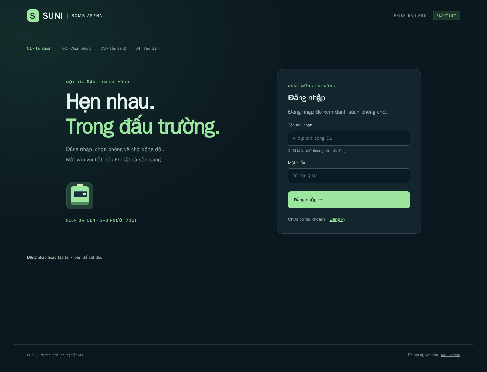
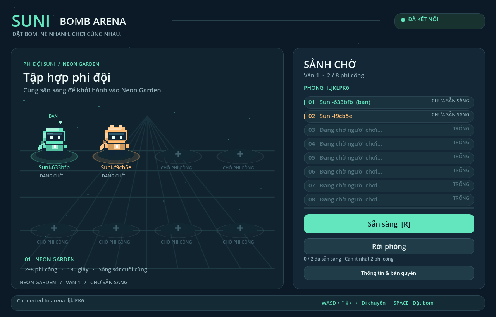
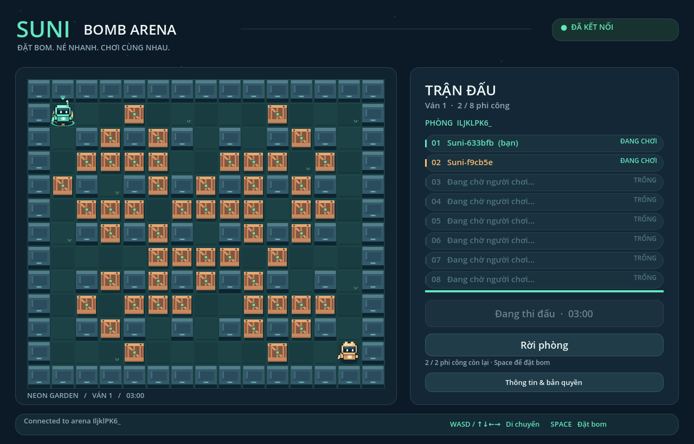
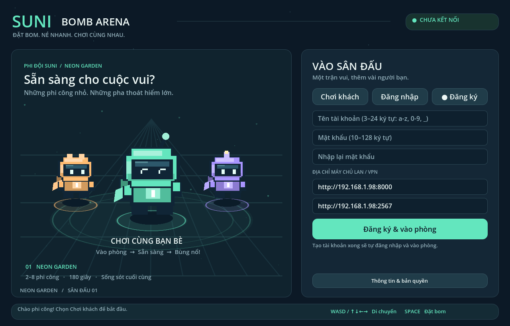

# Bụp Bụp! / Suni Bomb Arena

## Chơi trên website — hướng phát triển hiện tại

Bản web ở `apps/web` dùng API FastAPI và arena Colyseus hiện có: trang đăng ký/đăng nhập riêng, danh sách phòng chờ để chọn hoặc tạo phòng,
sảnh sẵn sàng 2–8 người, di chuyển, đặt bom, kết quả và ván tiếp theo.
Điều khiển bằng bàn phím hoặc nút cảm ứng, không cần cài ứng dụng.



```bash
# Chuẩn bị .env như hướng dẫn bên dưới, rồi chạy:
docker compose up -d --build --wait
# Mở http://127.0.0.1:8081 trong hai tab để chơi thử.
```

Web dùng `/api/` và `/arena/` cùng origin, chuyển tiếp tới API và WebSocket.
Không cần đổi CORS hoặc nhập địa chỉ máy chủ trong giao diện. Phiên tài khoản
chỉ giữ trong tab; tải lại trang cần đăng nhập lại.

Giao diện web và Windows hiện dùng bộ PNG trong hai ZIP người dùng cung cấp:
Bombo, Mimi, Zin, Lala, Kai cùng nền xanh đậm, sân cỏ và bom nước.
Xem [bộ nhân vật mới](docs/BOOM_ART.md) và [bản sửa di chuyển](docs/MOVEMENT.md).
Desktop được đóng gói thủ công; CI chưa tự xuất bản desktop.

Xem [hướng dẫn web](docs/WEB.md), [danh sách công việc](docs/TASKS.md) và
[kết quả kiểm thử](docs/VALIDATION.md).

Dev tích hợp realtime: [tính năng server Colyseus](docs/ARENA.md) liệt kê
những gì đã có, vòng đời phòng, endpoint, message/snapshot và giới hạn hiện tại.
Đọc trực tiếp tại <https://arena.sunifactory.com/documents> (không cần đăng nhập).

## Bản desktop cũ

Prototype multiplayer 2D pixel art nguyên bản: Godot 4.4.1, Colyseus 0.17 + TypeScript,
FastAPI, PostgreSQL 16, Redis 7.2. Server quyết định trạng thái và thắng thua.



Sảnh chờ có tám bục phi công, trạng thái sẵn sàng và đánh dấu người chơi của bạn.
Nhân vật pixel tự vẽ có tám màu, bốn kiểu mũ, hoạt ảnh chớp mắt, bước chân và vẫy tay.
Trong trận có ngòi bom phát sáng, tia nổ liền mạch, bụi bước chân và mảnh thùng vỡ.



## Chạy nhanh trên Ubuntu

Cần Docker Engine + Compose plugin, Git và Godot 4.4.1 bản standard.
Xem [hướng dẫn Ubuntu](docs/DEPLOYMENT.md) để cài Docker và vận hành.

```bash
cp .env.example .env
# Điền hai giá trị khác nhau vào POSTGRES_PASSWORD và JWT_SECRET:
openssl rand -hex 32
openssl rand -hex 32
docker compose up -d --build --wait
docker compose ps
```

Mở `apps/client/project.godot` bằng Godot và nhấn F5. Client điền sẵn
`https://api.sunifactory.com` và `https://arena.sunifactory.com` qua Cloudflare Tunnel.
Khi chạy Compose mặc định trên
cùng máy, đổi hai URL thành `http://127.0.0.1:8000` và `http://127.0.0.1:2567`.
Mở hai instance client, chọn **Chơi khách → Vào chơi ngay** rồi **Sẵn sàng** ở cả hai.
Mỗi client được tạo tài khoản khách riêng. Để dùng tài khoản lâu dài, chọn
**Đăng ký**, nhập tên tài khoản (3–24 ký tự `a-z`, `0-9`, `_`), mật khẩu
(10–128 ký tự) và nhập lại mật khẩu. Game tự đăng nhập và vào phòng sau khi tạo.
Lần mở game sau, chọn **Đăng nhập** với tài khoản đó.

Rời phòng giữ phiên tài khoản trong bộ nhớ để vào lại; nút **Đăng xuất** xuất hiện
trên màn hình vào phòng. Game không lưu mật khẩu hoặc token ra đĩa. Khi đóng game
hoặc phiên hết hạn, cần nhập lại mật khẩu. Tài khoản khách chưa chuyển được thành
tài khoản đăng ký.



| Phím           | Thao tác         |
| -------------- | ---------------- |
| WASD / mũi tên | Di chuyển từng ô |
| Space          | Đặt bom          |
| R / nút Ready  | Sẵn sàng ở lobby |

Bản đồ **Neon Garden** 15×13, 2–8 người. Một bom/người, nổ sau 2 giây,
tầm 2 ô theo bốn hướng. Tường chặn tia nổ; thùng bị phá và chặn phần tia còn lại.
Bom kích nổ dây chuyền. Lửa tồn tại 0,5 giây. Người sống cuối thắng; chết đồng thời
hoặc hết 180 giây là hòa. Sau 8 giây hiển thị kết quả, phòng về lobby.
Mất kết nối bị loại; Join lại tìm phòng mới. Không cho vào trận đang diễn ra.

Bản dùng thử độc lập cho Windows/Linux qua Internet hoặc LAN/VPN:
[chuẩn bị server và tải/build gói](docs/PLAYTEST.md),
[hướng dẫn người chơi](docs/PLAYTEST_PLAYER.md).

## Monorepo

```text
apps/client/          Godot project, hình khối pixel tự vẽ, adapter và smoke test
apps/web/             Website, adapter API/WebSocket, Nginx và kiểm thử trình duyệt
apps/arena/src/       mô phỏng độc lập + phòng Colyseus + xác thực JWT
apps/arena/tests/     unit test gameplay và WebSocket thật với 8 client
apps/api/app/         tài khoản khách/đăng ký/đăng nhập, inventory, VIP chỉ đọc
apps/api/tests/       API tests với SQLite và Redis limiter giả lập
infra/postgres/      schema SQL ban đầu
scripts/             kiểm tra Godot, thu thập license
.github/workflows/   CI và xuất bản Docker image thủ công
docs/                kiến trúc, triển khai và quy trình PR
```

## Phát triển và kiểm thử

Node **22.13+**, Python **3.12**, uv **0.13.0**, Godot **4.4.1**.

```bash
npm ci
npm run lint
npm test
npm run build
npm run format:check
# JWT_SECRET phải giống API:
set -a
source .env
set +a
npm run dev
```

API:

```bash
uv sync --locked --project apps/api --python 3.12
uv run --project apps/api ruff check apps/api
uv run --project apps/api ruff format --check apps/api
cd apps/api
uv run pytest
```

API local cần `DATABASE_URL`, `REDIS_URL`, `JWT_SECRET` và schema đã khởi tạo;
dùng Compose là cách đơn giản nhất vì database không publish port ra host.
Swagger: <http://127.0.0.1:8000/docs>.

Godot và toàn bộ stack:

```bash
bash scripts/install-godot.sh /tmp/suni-godot
GODOT=/tmp/suni-godot/godot python3 scripts/check-godot.py
docker compose up -d --build --wait
/tmp/suni-godot/godot --headless --path apps/client --script res://tests/smoke.gd
/tmp/suni-godot/godot --headless --path apps/client --script res://tests/lobby.gd
/tmp/suni-godot/godot --headless --path apps/client --script res://tests/accounts.gd
mkdir -p apps/client/build
/tmp/suni-godot/godot --headless --path apps/client --export-pack Linux build/suni-bomb-arena.pck
/tmp/suni-godot/godot --main-pack apps/client/build/suni-bomb-arena.pck
```

Resource pack `.pck` build thủ công, chạy bằng Godot 4.4.1. Muốn executable độc lập:
cài export templates 4.4.1 từ Godot, rồi `godot --headless --path apps/client --export-release Linux`.
Format TypeScript/Markdown/YAML: `npm run format`; Python: `uv run --project apps/api ruff format apps/api`.
GDScript dùng tab, kiểm tra parse/runtime bằng Godot.

Test `lobby.gd` kiểm tra vào phòng, sẵn sàng, đếm ngược, kết quả, tự về sảnh,
rời phòng và vào lại bằng hai client thật. Dùng `SUNI_API_URL` và `SUNI_ARENA_URL`
nếu server không nằm trên loopback. Để chụp giao diện, chạy test này với display
đồ họa (bỏ `--headless`) và đặt `SUNI_CAPTURE_DIR` trỏ tới thư mục ảnh đã tạo.

Test `accounts.gd` tạo tài khoản thử nghiệm có tên ngẫu nhiên trên server được cấu hình,
kiểm tra form, đăng ký, đăng nhập sai/đúng, trùng tên, thử lại khi arena lỗi,
rời phòng, đăng xuất và phiên hết hạn. Chỉ chạy trên server phát triển/kiểm thử.

## Phạm vi giai đoạn 1

Gameplay multiplayer authoritative, guest/login JWT, inventory mặc định và VIP chỉ đọc,
Docker healthchecks, CI lint/test/build và workflow publish image lên GHCR thủ công.
Tài khoản/inventory lưu PostgreSQL; Redis giới hạn tần suất auth; trận nằm trong RAM.
Restart arena làm mất trận đang chơi. Chưa có replay, xếp hạng, matchmaking theo kỹ năng,
khôi phục kết nối, migration tự động hoặc nhiều arena replica.
Guest mới mỗi lần Join; chưa có chuyển guest thành tài khoản hoặc refresh token.
Token hết hạn sau một giờ; kiểm tra khi vào phòng, không đá người đang chơi giữa trận.
VIP không làm thay đổi gameplay, không có API cấp VIP hay thanh toán thật.

Chi tiết: [kiến trúc/protocol](docs/ARCHITECTURE.md), [triển khai](docs/DEPLOYMENT.md),
[PR nhỏ](docs/PULL_REQUESTS.md), [license/asset](THIRD_PARTY_NOTICES.md).
