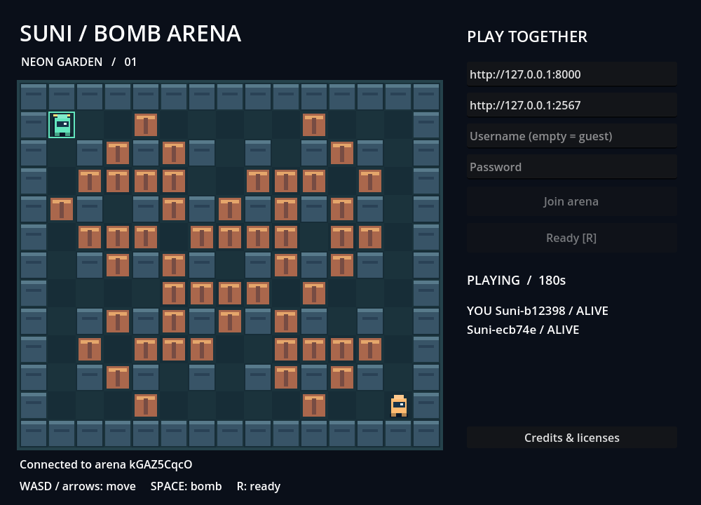

# Suni Bomb Arena

Prototype multiplayer 2D pixel art nguyên bản: Godot 4.4.1, Colyseus 0.17 + TypeScript,
FastAPI, PostgreSQL 16, Redis 7.2. Server quyết định trạng thái và thắng thua.



## Chạy nhanh trên Ubuntu

Cần Docker Engine + Compose plugin, Git và Godot 4.4.1 bản standard.
Xem [hướng dẫn Ubuntu](docs/DEPLOYMENT.md) để cài Docker và vận hành.

```bash
cp .env.example .env
# Điền hai giá trị khác nhau vào POSTGRES_PASSWORD và JWT_SECRET:
openssl rand -hex 32
openssl rand -hex 32
docker compose up -d --build --wait
docker compose ps
```

Mở `apps/client/project.godot` bằng Godot và nhấn F5. Mở hai instance client,
giữ URL mặc định, bấm **Join arena** rồi **Ready** ở cả hai. Để username trống
để tạo tài khoản khách riêng; tài khoản đăng ký qua API có thể đăng nhập bằng username/password.

| Phím           | Thao tác         |
| -------------- | ---------------- |
| WASD / mũi tên | Di chuyển từng ô |
| Space          | Đặt bom          |
| R / nút Ready  | Sẵn sàng ở lobby |

Bản đồ **Neon Garden** 15×13, 2–8 người. Một bom/người, nổ sau 2 giây,
tầm 2 ô theo bốn hướng. Tường chặn tia nổ; thùng bị phá và chặn phần tia còn lại.
Bom kích nổ dây chuyền. Lửa tồn tại 0,5 giây. Người sống cuối thắng; chết đồng thời
hoặc hết 180 giây là hòa. Sau 8 giây hiển thị kết quả, phòng về lobby.
Mất kết nối bị loại; Join lại tìm phòng mới. Không cho vào trận đang diễn ra.

Bản dùng thử độc lập cho Windows/Linux qua LAN/VPN:
[chuẩn bị server và tải/build gói](docs/PLAYTEST.md),
[hướng dẫn người chơi](docs/PLAYTEST_PLAYER.md).

## Monorepo

```text
apps/client/          Godot project, hình khối pixel tự vẽ, adapter và smoke test
apps/arena/src/       mô phỏng độc lập + phòng Colyseus + xác thực JWT
apps/arena/tests/     unit test gameplay và WebSocket thật với 8 client
apps/api/app/         tài khoản khách/đăng ký/đăng nhập, inventory, VIP chỉ đọc
apps/api/tests/       API tests với SQLite và Redis limiter giả lập
infra/postgres/      schema SQL ban đầu
scripts/             kiểm tra Godot, thu thập license
.github/workflows/   CI và xuất bản Docker image thủ công
docs/                kiến trúc, triển khai và quy trình PR
```

## Phát triển và kiểm thử

Node **22.13+**, Python **3.12**, uv **0.13.0**, Godot **4.4.1**.

```bash
npm ci
npm run lint
npm test
npm run build
npm run format:check
# JWT_SECRET phải giống API:
set -a
source .env
set +a
npm run dev
```

API:

```bash
uv sync --locked --project apps/api --python 3.12
uv run --project apps/api ruff check apps/api
uv run --project apps/api ruff format --check apps/api
cd apps/api
uv run pytest
```

API local cần `DATABASE_URL`, `REDIS_URL`, `JWT_SECRET` và schema đã khởi tạo;
dùng Compose là cách đơn giản nhất vì database không publish port ra host.
Swagger: <http://127.0.0.1:8000/docs>.

Godot và toàn bộ stack:

```bash
bash scripts/install-godot.sh /tmp/suni-godot
GODOT=/tmp/suni-godot/godot python3 scripts/check-godot.py
docker compose up -d --build --wait
/tmp/suni-godot/godot --headless --path apps/client --script res://tests/smoke.gd
mkdir -p apps/client/build
/tmp/suni-godot/godot --headless --path apps/client --export-pack Linux build/suni-bomb-arena.pck
/tmp/suni-godot/godot --main-pack apps/client/build/suni-bomb-arena.pck
```

CI build resource pack `.pck`, chạy bằng Godot 4.4.1. Muốn executable độc lập:
cài export templates 4.4.1 từ Godot, rồi `godot --headless --path apps/client --export-release Linux`.
Format TypeScript/Markdown/YAML: `npm run format`; Python: `uv run --project apps/api ruff format apps/api`.
GDScript dùng tab, kiểm tra parse/runtime bằng Godot.

## Phạm vi giai đoạn 1

Gameplay multiplayer authoritative, guest/login JWT, inventory mặc định và VIP chỉ đọc,
Docker healthchecks, CI lint/test/build và workflow publish image lên GHCR thủ công.
Tài khoản/inventory lưu PostgreSQL; Redis giới hạn tần suất auth; trận nằm trong RAM.
Restart arena làm mất trận đang chơi. Chưa có replay, xếp hạng, matchmaking theo kỹ năng,
khôi phục kết nối, migration tự động hoặc nhiều arena replica.
Guest mới mỗi lần Join; chưa có chuyển guest thành tài khoản hoặc refresh token.
Token hết hạn sau một giờ; kiểm tra khi vào phòng, không đá người đang chơi giữa trận.
VIP không làm thay đổi gameplay, không có API cấp VIP hay thanh toán thật.

Chi tiết: [kiến trúc/protocol](docs/ARCHITECTURE.md), [triển khai](docs/DEPLOYMENT.md),
[PR nhỏ](docs/PULL_REQUESTS.md), [license/asset](THIRD_PARTY_NOTICES.md).
