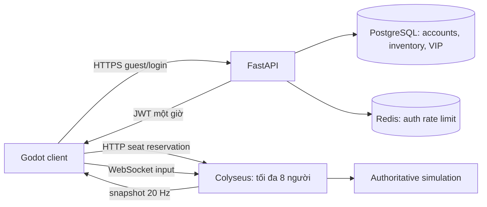

# Kiến trúc giai đoạn 1

Một process Colyseus dùng local matchmaking/presence. Redis không lưu trận hoặc
mở rộng cluster. Không chạy nhiều replica arena với cấu hình hiện tại.

## Luật mô phỏng

- Server tick 50 ms, tối đa một ô/150 ms. Host quá tải làm simulation chậm;
  client không được tự đẩy thời gian server.
- `waiting → countdown (3 giây) → playing → finished (8 giây) → waiting`.
  Tất cả người trong lobby phải Ready, tối thiểu hai người.
- Một input đang chờ/người/tick, bomb ưu tiên movement. Chỉ nhận enum hợp lệ.
  Session ID do Colyseus cấp, không lấy từ payload.
- Client không gửi tọa độ, damage, tốc độ, timer hoặc winner. JWT xác thực issuer,
  audience, chữ ký HS256 và expiry. Tên lấy từ JWT đã ký.
- Rời phòng khi countdown: hủy countdown, mọi người Ready lại. Khi đang chơi:
  bị loại, bom đã đặt vẫn tồn tại. Không nhận người vào giữa trận.
- Hủy bom trước chain reaction để tránh đệ quy vô hạn. Tia nổ dừng tại
  tường/thùng/bom đầu tiên. Mọi vụ nổ cùng tick xử lý trước khi tính winner.
  Bom xử lý theo thứ tự đặt; thùng vừa phá có thể cho vụ nổ xử lý sau cùng tick đi qua.
- Chủ bom được rời ô đang đứng nhưng không đi ngược vào bom. Người sống chặn nhau.
- `winner = null` là hòa. Không có API ghi kết quả từ client; chưa lưu lịch sử trận vào DB.

## Adapter Godot / Colyseus 0.17

Adapter tự viết, giới hạn phạm vi, khóa phiên bản bằng lockfile; không phải SDK tổng quát.
Arena dùng hostname riêng, không có URL path prefix.

1. `POST /v1/guests` hoặc `/v1/login` để nhận JWT.
2. `POST /matchmake/joinOrCreate/arena`, JSON `{ "token": "..." }`.
3. Colyseus 0.17 trả object phẳng: `sessionId`, `roomId`, `processId`.
4. Mở `ws(s)://host/processId/roomId?sessionId=...`.
5. `onAuth` chạy trong WebSocket handshake; seat HTTP thành công chưa có nghĩa
   đăng nhập thành công. Token sai bị ERROR (11) rồi ngắt kết nối.
6. Nhận JOIN_ROOM (10), ACK `[10]`. Serializer `none`, không dùng Schema patches.
7. Input: `[13, 0, 0xa0 + độ_dài, ...ASCII]`: type số `0`, MsgPack fixstr.
   Enum: `up`, `down`, `left`, `right`, `bomb`, `ready`.
8. Snapshot: `[17, 1, ...UTF8_JSON]`, `broadcastBytes`/`sendBytes`, type số `1`.
   JSON version 1: grid, players, bombs, flames, phase, now, deadline, winner, round.
9. LEAVE_ROOM `[12]`. Không reconnect; join lại tạo seat mới.

`network.test.ts` mở WebSocket thật với tám client; `smoke.gd` chạy chính adapter Godot
qua FastAPI/PostgreSQL/Redis/Colyseus. Khi nâng Colyseus phải chạy cả hai.
Nguồn: package đã cài và [Colyseus room messages](https://docs.colyseus.io/room).

## Backend

Username chữ thường 3–24 ký tự (`a-z0-9_`), password 10–128 ký tự, Argon2id qua pwdlib.
Register/guest nhận `pilot_default`. Inventory/VIP chỉ đọc theo danh tính JWT;
không nhận account ID tùy ý. Chưa có reset password/refresh/revoke.
JWT secret dùng chung API/arena, tối thiểu 32 ký tự, nên sinh 32 byte ngẫu nhiên.
Không log token/password/sessionId.

Redis limiter atomic: 20 lần auth/IP/phút; lỗi Redis trả 503. Matchmaking:
30 HTTP request/IP/phút, 40 packet/client/giây, payload WebSocket 1 KB.
Sau reverse proxy, mặc định gộp limit theo IP proxy; chưa tin `X-Forwarded-For`.
Một tài khoản chỉ có một seat trong cùng phòng, chưa giới hạn giữa nhiều phòng.
