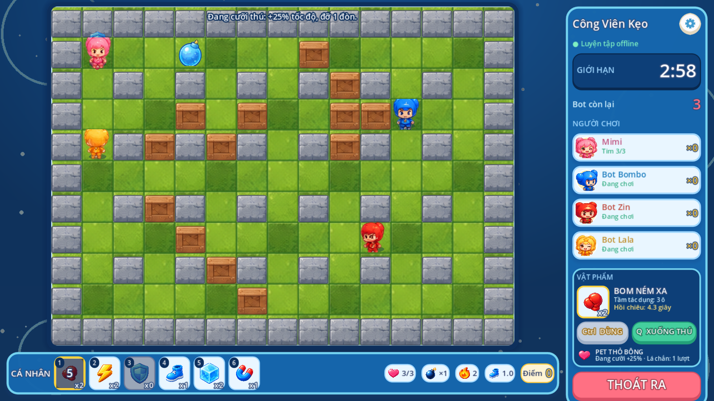
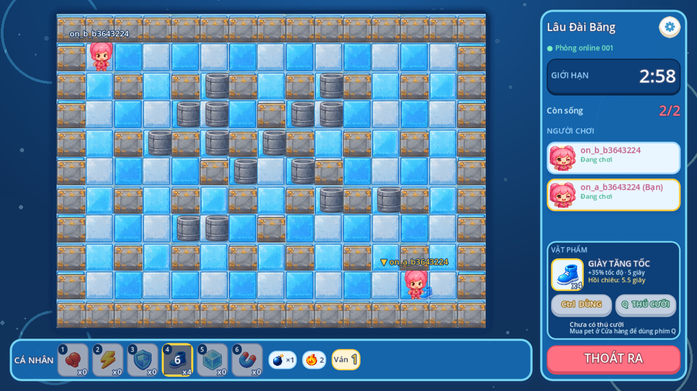

# Vật phẩm trong trận (Battle HUD)

Bố cục lấy từ gói `Game_Boom_Battle_HUD_Package` (chỉ lấy vị trí/tỷ lệ; hình, tên và
icon là của game này). Áp dụng cho **Luyện tập** (trên máy) và **Online** (server).




## Giao diện

- **VẬT PHẨM** (sidebar, dưới danh sách người chơi): icon vật phẩm đang chọn, số lượng,
  tầm tác dụng, hồi chiêu / sẵn sàng / hết vật phẩm, nút **Ctrl DÙNG**, nút **Q THÚ CƯỠI**
  và trạng thái thú (đang cưỡi, lá chắn 1 lượt). Có pet thì mỗi ván bắt đầu đang cưỡi.
- **CÁ NHÂN** (thanh dưới sân): 6 ô phím 1–6. Ô chọn viền vàng; hồi chiêu = lớp tối + số
  giây; hết = xám, `x0`. Bấm chuột vào ô cũng chọn.
- Component chung: `apps/practice/scripts/ui/pc/battle_item_ui.gd` (chỉ hiển thị, nhận
  `view` từ luật Luyện tập hoặc từ snapshot server).

## Phím

| Phím  | Tác dụng                                         |
| ----- | ------------------------------------------------ |
| Space | Bom thường (không tốn vật phẩm)                  |
| 1–6   | Chọn ô vật phẩm                                  |
| Ctrl  | Dùng vật phẩm đang chọn theo hướng nhân vật nhìn |
| Q     | Lên / xuống thú cưỡi                             |

Khi ô chat đang focus, phím trận không hoạt động.

## Vật phẩm

| Ô   | id            | Hiệu ứng                                                                     | Hồi   |
| --- | ------------- | ---------------------------------------------------------------------------- | ----- |
| 1   | `throw_bomb`  | Ném bom tới ô trống xa nhất ≤3 ô, không qua tường; không chiếm lượt bom      | 5 s   |
| 2   | `dart`        | Bay ≤5 ô, chạm bom đầu tiên là nổ ngay; tường/thùng chặn                     | 0,8 s |
| 3   | `blue_shield` | Chặn 1 lần trúng bom trong 8 s                                               | 8 s   |
| 4   | `speed_shoes` | +35% tốc độ trong 5 s                                                        | 6 s   |
| 5   | `freeze_bomb` | Làm chậm đối thủ vùng 3×3 (cách tối đa 2 ô phía trước) trong 3 s             | 6 s   |
| 6   | `push_glove`  | Đẩy bom ngay phía trước trượt tới khi gặp vật cản (≤8 ô)                     | 5 s   |
| Q   | thú cưỡi      | Xuống / lên pet (vào ván đã cưỡi); +25% tốc độ, đỡ 1 đòn rồi hết tới ván sau | —     |

Vật phẩm chỉ bị trừ khi lần dùng có tác dụng (ví dụ ném xa cần ô trống, đẩy bom cần có
bom phía trước). Gói trong Cửa hàng bán **×5** (cột `quantity` của `item_catalog`).

## Số lượng và tiêu hao

- Số lượng = kho đồ đã mua (`inventory_stock`), tối đa 99 mang vào trận.
- **Online**: khi ngồi vào phòng, arena đọc `GET /internal/v1/arena/loadout/{account}`
  (token dịch vụ), gồm danh sách pet sở hữu `pets`; pet client xin khi vào phòng (`pet`)
  chỉ được nhận nếu có trong danh sách đó. Client chỉ gửi intent `use_<id>` / `mount`;
  server kiểm tra số lượng, hồi chiêu, hướng, tầm và va chạm, rồi báo `POST /internal/v1/arena/events`
  `{type: "use", account_id, item_id, use_id}`. API trừ kho đúng một lần theo `use_id`
  (bảng `item_uses`). Snapshot v2 thêm cho mỗi người: `facing, items, cooldowns (ms còn
lại), pet, mounted, petUsed, shield, fast, slow`, và `effects` (sự kiện ~1 s) để mọi
  người thấy ném/phi tiêu/đóng băng/khiên/thú.
- **Luyện tập** (trận chạy trên máy): đã đăng nhập thì mỗi lần dùng gọi
  `POST /v1/inventory/use {item_id, request_id}` (idempotent); khách dùng kho demo.
  Bot không dùng vật phẩm.

Thay đổi giao thức là **bổ sung** trong phòng `arena2`: intent mới và trường snapshot mới;
client cũ bỏ qua trường lạ và không gửi intent mới.

## Kiểm thử

```bash
cd apps/api && uv run pytest tests/test_battle_items.py
npm test   # apps/arena: "v2 items" + "battle items over the wire"
godot --headless --path apps/practice --script res://tests/battle_items.gd
SUNI_API_URL=http://127.0.0.1:8081/api godot --path apps/practice --script res://tests/online.gd
```

## Triển khai

1. Sao lưu DB, chạy `infra/postgres/010_battle_items.sql` (cột `quantity`, 4 vật phẩm mới,
   bảng `item_uses`).
2. Nạp icon cho vật phẩm mới: `python -m app.admin_cli import-icons <thư mục assets>`.
3. Build image API + arena mới, cập nhật tag trong `.env`.
