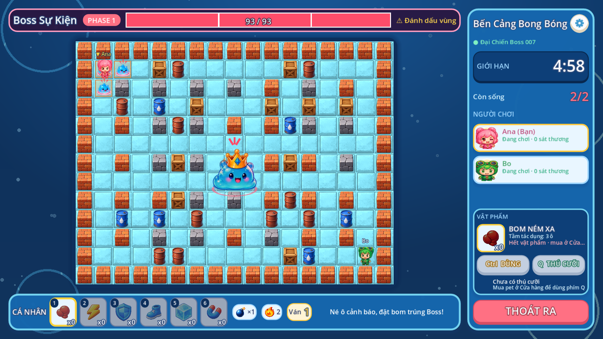
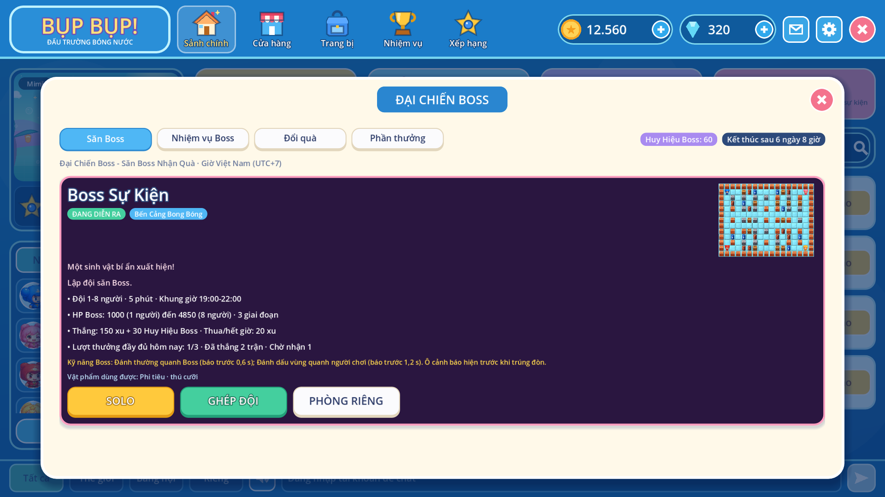

# Đại Chiến Boss (Boss Raid PvE)

Chế độ cả đội 1-8 người cùng đánh một Boss do máy chủ điều khiển, theo gói tài liệu
`BUPBUP_Boss_Event_Dev_Package.zip` (đặc tả v1.0). Mọi con số (HP, thưởng, giới hạn)
là **số mẫu** để chơi thử, cần Product Owner duyệt trước khi mở sự kiện thật. Hình Boss
**chưa chốt**: app dùng hình placeholder và đổi art bằng `asset_pack_id`.




## Luồng người chơi

1. Sảnh PC → **SĂN BOSS**: xem lịch (giờ Việt Nam), bản đồ, số người, HP Boss, kỹ năng,
   vật phẩm dùng được, thưởng, lượt thưởng còn lại trong ngày.
2. Chọn **Solo**, **Ghép đội** (vào phòng công khai đang chờ của sự kiện, không có thì mở
   phòng mới) hoặc **Phòng riêng** (chỉ mời; mặc định không nhận thưởng kinh tế).
3. Phòng chờ: tối đa `max_players` ghế, có thể chơi một mình; tất cả **Sẵn sàng** → đếm 3 s.
4. Trận: đặt bom nước trúng Boss, né ô cảnh báo. Thanh HP có vạch phase.
5. Kết thúc: **WIN / LOSE / TIMEOUT / ABORT** do máy chủ quyết định. Màn kết quả lấy
   sát thương, hỗ trợ và điều kiện thưởng từ API, rồi hiện nút **NHẬN THƯỞNG** (hoặc lý do
   không có thưởng).
6. Tab **Nhiệm vụ Boss**, **Đổi quà** (Huy Hiệu Boss) và **Phần thưởng** (thưởng chưa nhận).

## Luật trận (arena, `apps/arena/src/boss.ts`)

- Luật bom, nổ dây chuyền, vật phẩm, thú cưỡi giống PvP (`Arena`). `BossArena` thêm Boss.
- Boss chiếm **3×3 ô giữa bản đồ** (`FOOTPRINT`; ô đó luôn trống, không đi qua được). Tia nổ
  dừng ở Boss như gặp tường. **Mỗi quả bom trúng Boss đúng một lần** (cả khi nổ dây chuyền,
  theo bomb id): `bomb_damage` (mẫu 50), ×`weak_multiplier` (1,5) khi lộ điểm yếu.
- HP chốt lúc trận bắt đầu: `round(base_hp × (1 + hp_per_extra_player × (n − 1)))`;
  1 người 1 000, 8 người 4 850. Người rời phòng sau đó không làm giảm HP.
- Phase theo `phase_thresholds` (mẫu 0,70 / 0,35): mỗi ngưỡng đổi đúng một lần, không lùi.
- Thắng: HP về 0 trước khi hết giờ. Thua: không còn ai sống. Hết giờ: TIMEOUT. Mọi người rời
  phòng hoặc máy chủ dừng giữa trận: ABORT (không thưởng, không trừ lượt).
- Đòn Boss: khiên hoặc thú cưỡi đỡ một lần như PvP; trúng đòn khi không có lá chắn là bị loại.

### Kỹ năng

| Skill ID          | Báo trước | Tác dụng                                                     | Phase |
| ----------------- | --------: | ------------------------------------------------------------ | ----- |
| `boss_basic_hit`  |     0,6 s | Đánh các ô quanh Boss                                        | 1-3   |
| `boss_aoe_mark`   |     1,2 s | Vùng 3×3 quanh 1 / 2 / 3 người (phase 3: 5×5)                | 1-3   |
| `boss_block_lane` |     1,0 s | Tối đa 4 vật cản tạm trên một hàng/cột qua Boss, 3 s         | 2-3   |
| `boss_wave_push`  |     1,5 s | Đẩy người và bom trong dải ngang/dọc qua Boss 2 ô theo hướng | 2-3   |
| `boss_weak_point` |     0,4 s | Lộ điểm yếu 3 s (×1,5 sát thương), mỗi lần cast thứ 3        | 3     |

- Mỗi lúc chỉ có **một** ô cảnh báo; nghỉ giữa hai chiêu 1,6 / 1,2 / 0,8 s theo phase.
- **Bảo đảm lối thoát:** trước mỗi đòn gây sát thương, máy chủ kiểm tra (BFS theo tốc độ đi
  của từng người) mọi người còn sống đều tới được một ô an toàn trước khi trúng. Không có
  lối thì không cast chiêu đó. Chặn ô không bao giờ nhốt ai (mỗi người còn ≥ 4 ô đi được).
- Client vẽ đúng danh sách ô server gửi (`boss.casts[].tiles`), có gạch chéo và ký hiệu
  (!, !!, ▣, mũi tên, ★) để đọc được cả khi không phân biệt màu.

### Snapshot (phòng `boss`, giao thức v2)

Thêm vào snapshot v2: `mode: "boss"`,
`boss: {id, assetPack, name, x, y, size, hp, maxHp, phase, thresholds, weak, seq, casts}`,
`raid: {eventId, matchId, private, items, mount, open, result, minPlayers, maxPlayers, damage}`.
`casts[]` = `{id, skill, tiles, castAt, resolveAt, dir?}` (ms theo đồng hồ server `now`).

### Phòng và kết nối lại (`apps/arena/src/boss_room.ts`)

- `POST /matchmake/joinOrCreate/boss` `{event, hero, pet}` ghép đội theo sự kiện;
  `create/boss` `{event, private: true}` tạo phòng riêng. Luật đọc từ API khi tạo phòng;
  sự kiện không tồn tại / chưa mở → từ chối.
- Mỗi 15 s phòng hỏi lại API: sự kiện tạm dừng, hết giờ hoặc ngoài phiên → không mở trận mới
  (trận đang chơi được đánh tiếp).
- Rớt mạng giữa trận: giữ ghế 30 s. App PC tự nối lại bằng reconnection token của
  JOIN_ROOM (`reconnectionToken` trên URL WebSocket) và nhận ngay snapshot mới.
- Không cho vào giữa trận (khóa phòng khi không còn ở phòng chờ).
- Hết trận: báo `POST /internal/v1/arena/events` `{type: "boss_raid", match_id, result,
boss_hp_max, raiders: [{account_id, damage, support, actions, active_ms, alive}]}`.
  `match_id = <process>.<room>.<round>`; API ghi đúng một lần dù arena gửi lại.

## Sự kiện, thưởng và nhiệm vụ (API, `apps/api/app/boss.py`)

Sự kiện Boss là một sự kiện LiveOps (`events`, loại `boss`) có khối `config.boss`
(`liveops.BossRules`). Huy Hiệu Boss là **vé sự kiện** của sự kiện đó; nhiệm vụ Boss là nhiệm
vụ sự kiện với mục tiêu `BOSS_PLAYED`, `BOSS_WON`, `BOSS_DAMAGE`, `BOSS_SUPPORT`; Event Shop
dùng Huy Hiệu. Phát hành / tạm dừng / tiếp tục / phiên bản / audit dùng endpoint sự kiện sẵn có.

### Điều kiện nhận thưởng (mỗi người, mỗi trận)

1. Trận không ABORT; phòng riêng chỉ khi `reward_private_room` bật.
2. Có mặt ≥ `min(45 s, 50 % thời lượng trận)` và có ≥ `min_actions` (mẫu 10) thao tác được
   server chấp nhận (dưới mức = AFK).
3. Thắng: thêm điều kiện sát thương ≥ 1 % HP Boss **hoặc** ≥ 3 lần dùng vật phẩm hỗ trợ.
4. Còn lượt trong ngày (mẫu 3 lượt thưởng đầy đủ/người/ngày, giờ Việt Nam).

Thắng → `win_rewards` (mẫu 150 xu + 30 Huy Hiệu). Thua / hết giờ → `lose_rewards`
(mẫu 20 xu, không rương). Không đủ điều kiện → không thưởng, kèm lý do (`ABORTED`,
`PRIVATE_ROOM`, `NOT_ACTIVE`, `AFK`, `NO_CONTRIBUTION`, `DAILY_LIMIT`). Rương ngẫu nhiên
**chưa làm** (đặc tả cho phép MVP dùng Huy Hiệu đổi quà thay rương); vật phẩm thưởng cố định
thì thêm vào `win_rewards` dạng `item`.

Tiến độ nhiệm vụ Boss chỉ tính trận hợp lệ (không AFK / thiếu thời gian / phòng riêng /
ABORT), mỗi (người, trận) một lần; trận Boss không tính cho nhiệm vụ PvP và ngược lại.

### Endpoint

| Method | Path                                   | Ghi chú                                          |
| ------ | -------------------------------------- | ------------------------------------------------ |
| GET    | `/v1/boss/events`                      | Sự kiện đang chạy / sắp mở / tạm dừng / nhận quà |
| GET    | `/v1/boss/raids/{match_id}/result`     | Kết quả của chính người chơi                     |
| GET    | `/v1/boss/rewards`                     | Thưởng chưa nhận                                 |
| POST   | `/v1/boss/rewards/{grant_id}/claim`    | Idempotent; lần sau trả `already: true`          |
| GET    | `/internal/v1/boss/events/{id}`        | Token dịch vụ arena: `{open, rules}`             |
| GET    | `/admin/v1/events/template?kind=boss`  | Mẫu sự kiện Boss                                 |
| GET    | `/admin/v1/boss/events/{id}/analytics` | Trận, tỉ lệ thắng, TTK, phát thưởng, bị từ chối  |
| GET    | `/admin/v1/boss/events/{id}/raids`     | Danh sách trận và từng người                     |
| POST   | `/admin/v1/boss/events/{id}/settle`    | Sau hạn nhận thưởng: thưởng chưa nhận hết hạn    |

Nhận thưởng: một câu `UPDATE … WHERE status = 'ELIGIBLE'` đổi sang `CLAIMED`, chỉ giao dịch
thắng mới cộng ví (ledger `boss:<grant_id>`); hai thiết bị bấm cùng lúc chỉ nhận một lần.
Kill switch: `BOSS_EVENTS_ENABLED=0` trên API ẩn sự kiện Boss và chặn mở trận mới.

### Kiểm tra khi lưu / phát hành (admin)

Bản đồ tồn tại và đủ ghế; `1 ≤ min_players ≤ max_players ≤ 8`; ngưỡng phase giảm dần trong
(0, 1); kỹ năng hợp lệ, có ít nhất một đòn gây sát thương; phiên hợp lệ; vật phẩm thưởng tồn
tại. Cảnh báo: phòng riêng có thưởng, thưởng KC lớn, đội 8 người cần quá nhiều bom.

## Admin portal

**Sự kiện → Tạo từ mẫu “Đại Chiến Boss”** (hoặc bước **6. Boss** của sự kiện bất kỳ): Boss &
bản đồ, HP/sát thương/phase, kỹ năng, vật phẩm cho phép, phiên chơi, điều kiện nhận thưởng,
thưởng thắng/thua. **Thống kê → Xem số liệu Boss**: số trận, kết quả, tỉ lệ thắng, TTK trung
vị/p95, người tham gia, phát thưởng, lý do bị từ chối, chi tiết từng trận, **Kết toán**.

## Art Boss: Vua Slime

- Boss: **Vua Slime** (`assets/boss/slime_king`). App tìm
  `assets/boss/<asset_pack_id>/idle/01.png`; không có thì dùng Vua Slime, không có nữa thì
  silhouette. **Cùng một hình trong mọi trạng thái**, chỉ thêm hiệu ứng: vòng đỏ dưới chân và
  3 vạch "!" trên đầu khi ra chiêu, kéo dài thân khi chuyển phase, nháy đỏ khi trúng bom, ửng
  đỏ ở phase 3. Bị hạ: chính hình đó phồng lên, chớp trắng rồi vỡ thành nước và slime con.
- **To nhỏ:** Boss phình to / co nhỏ liên tục (±6 %), to thêm 4 % mỗi phase và phồng lên khi
  ném, nhưng **luôn nằm trong ô 3×3** (lúc to nhất vừa đúng 3×3); chân đứng trên mép dưới hitbox.
- **Ném slime con thay biểu tượng cảnh báo:** khi Boss ra Đánh thường / Đánh dấu vùng, nó ném
  một **Mini Slime Bomb** lên từng ô server cảnh báo (bay vòng cung ~0,4 s), slime con đứng
  nhấp nháy với vòng đỏ, rồi **nổ** đúng lúc server tính sát thương. Chặn ô dùng **Sticky
  Slime** (nổ thành vũng, ô thành vật cản). Ô vẫn có viền mảnh nhấp nháy bên dưới để đọc được
  cả khi không phân biệt màu. Sóng đẩy và lộ điểm yếu giữ ô cảnh báo cũ.
- Cắt bằng `tools/slice_slimes.gd` (Vua Slime, Mini Slime Bomb, Sticky Slime). 5 slime còn lại
  trong ảnh chưa dùng.

## Triển khai

1. Sao lưu DB, chạy `infra/postgres/014_boss.sql` (3 bảng `boss_raid_*`, `boss_reward_grants`).
2. Build image API và arena mới (cùng lúc: arena cần `/internal/v1/boss/events`).
3. Admin tạo sự kiện từ mẫu, kiểm tra, phát hành. App PC mới có nút SĂN BOSS.

## Kiểm thử

```bash
npm test   # apps/arena: tests/boss.test.ts (17) + "boss raid over the wire" (reconnect)
cd apps/api && uv run pytest tests/test_boss.py
godot --headless --path apps/practice --script res://tests/boss.gd
# Snapshot mẫu cho boss.gd sinh từ mô phỏng thật:
cd apps/arena && npx tsx scripts/boss_fixture.ts ../practice/tests/fixtures/boss_snapshots.json
```

Đối chiếu checklist QA của gói tài liệu:

| QA    | Nội dung                        | Kiểm thử                                                  |
| ----- | ------------------------------- | --------------------------------------------------------- |
| 01    | Chưa tới giờ / ngoài phiên      | `test_scheduled_events…`, `test_arena_reads_rules…`       |
| 02    | Solo, HP 1 người                | `boss.test.ts` HP scale, network test solo WIN            |
| 03-04 | 8 người, không có người thứ 9   | `boss.test.ts` eight seats (Colyseus `maxClients`)        |
| 05    | Phase 70 % / 35 % một lần       | `boss.test.ts` phases                                     |
| 06    | Ô cảnh báo = ô trúng, có lối né | `boss.test.ts` telegraph, no-escape; `boss.gd` cùng ô     |
| 07    | Nổ dây chuyền không trừ HP đúp  | `boss.test.ts` footprint/chain                            |
| 08-10 | WIN / TIMEOUT / LOSE            | `boss.test.ts`, network test                              |
| 11-12 | AFK, phòng riêng, lý do         | `test_raid_rewards…`, `test_daily_limit…`, `boss.gd`      |
| 12-14 | Nhận 2 lần, gửi lại kết quả     | `test_claim_is_idempotent…`, `test_raid_rewards…` (retry) |
| 15-16 | Hết 3 lượt/ngày                 | `test_daily_limit…`                                       |
| 16    | Kết nối lại                     | network test (terminate → reconnectionToken), `boss.gd`   |
| 17    | Tạm dừng sự kiện                | `test_arena_reads_rules…`, `boss.test.ts` closed event    |
| 18-20 | Server dừng → ABORT             | `boss.test.ts` ABORT; `BossRoom.onDispose` báo ABORT      |
| 19    | Sai map/item/skill              | `test_admin_validation…`                                  |

**Chưa kiểm thử:** tải 100+ phòng, bão reconnect, chạy trên Windows thật và trên stack thật
(API + arena + app cùng lúc). Số cân bằng (HP, sát thương, thưởng) chưa playtest.
