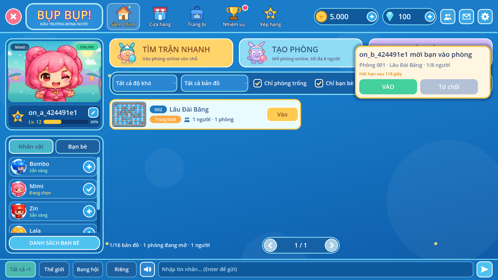
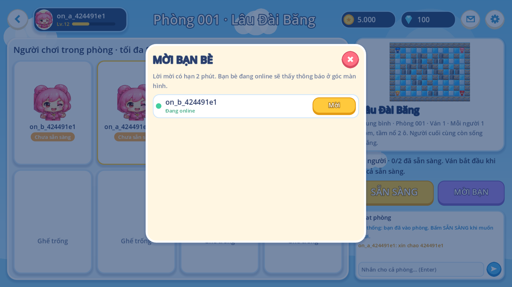
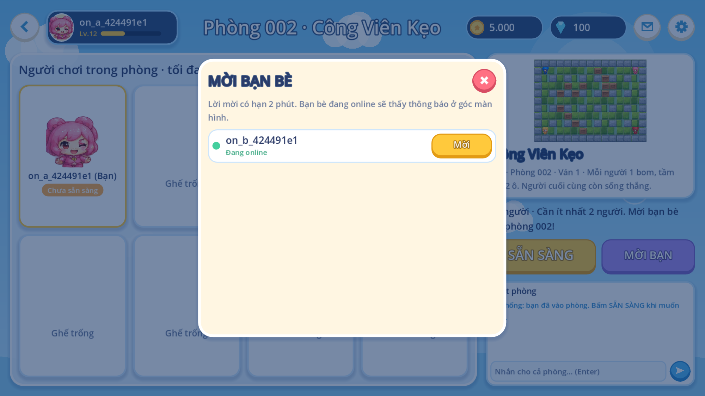
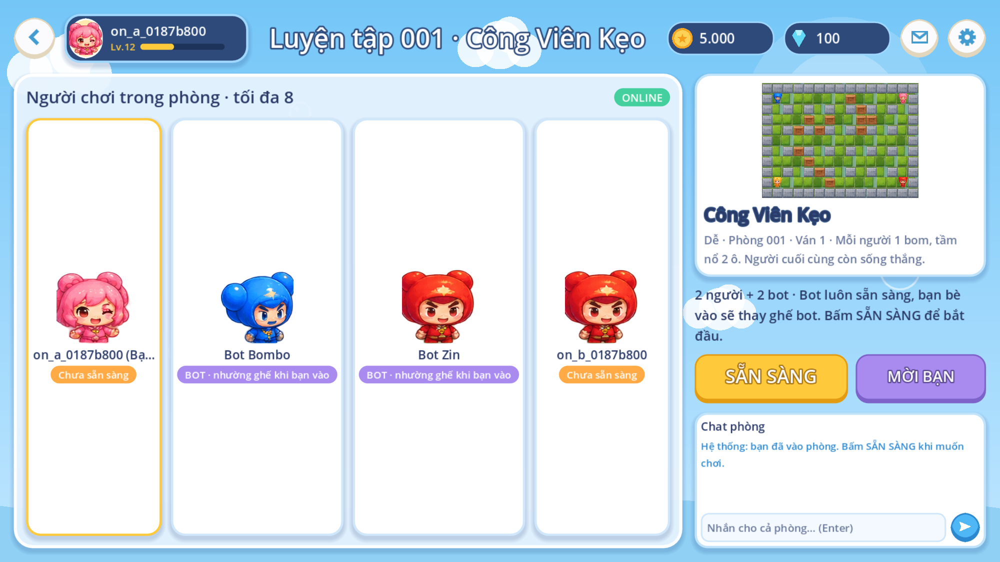
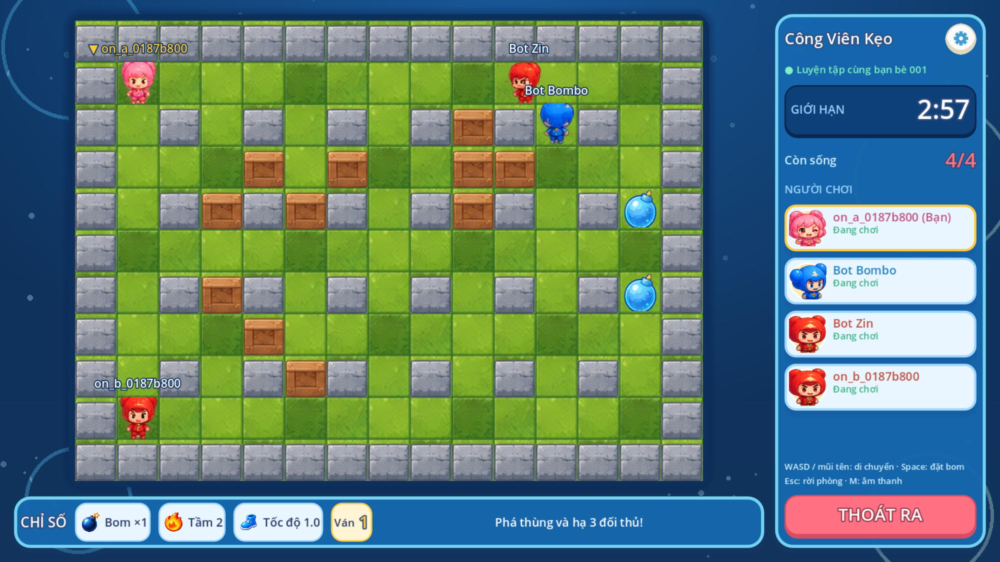

# Mời bạn bè vào trận

## Người chơi (app PC)

- **Phòng online** (phòng chờ): nút **MỜI BẠN** mở danh sách bạn bè đã chấp nhận, bạn
  đang online (chấm xanh) ở trên cùng. Bấm **Mời** gửi lời mời; nút tắt khi ván đang chơi
  hoặc phòng đã đủ 8 người.
- **Phòng Luyện tập**: ô **+ Mời** mở **phòng luyện tập online** trên cùng bản đồ: bạn +
  3 bot do server điều khiển, tối đa 4 ghế, rồi tự mở danh sách mời. Bạn bè nhận lời sẽ
  **thay ghế một bot**; ai rời phòng lúc đang chờ thì bot vào lại. Bot luôn sẵn sàng nên
  chỉ cần người chơi bấm SẴN SÀNG. Phòng này riêng tư: không hiện ở sảnh, chỉ vào qua lời
  mời.
- **Người nhận**: thẻ nổi góc trên phải ở sảnh, phòng chờ, màn kết quả (không hiện giữa
  trận Luyện tập): “X mời bạn vào phòng 001 · Lâu Đài Băng · 1/8 người”, đếm ngược hạn
  2 phút, **VÀO** (vào thẳng phòng) / **Từ chối**. App hỏi lời mời mỗi 4 giây khi đã đăng
  nhập và chưa ở trong phòng online.

## Bot trên server (`apps/arena/src/bots.ts`)

- Bot chỉ gửi intent như người chơi (`up/down/left/right/bomb`), nên tuân mọi luật: tốc độ
  di chuyển, 1 bom, va chạm. Quyết định đọc trạng thái server: né ô có lửa hoặc nằm trong
  tầm nổ của bom, đi tới cạnh thùng hoặc đối thủ, chỉ đặt bom khi còn đường thoát trước
  khi bom nổ.
- Tạo phòng: `create/arena2` với `{map, hero, practice: true}`. Snapshot v2 có thêm
  `practice: true`, `seats: 4` và `players[].bot: true` (trường bổ sung, client cũ bỏ
  qua).
- Trận có bot được server xác thực nhưng tính là chế độ **Luyện tập** cho nhiệm vụ (chỉ cộng
  khi admin bật “Luyện tập” cho nhiệm vụ đó).

## Quy tắc server (`apps/api/app/invites.py`)

- Chỉ mời bạn bè đã chấp nhận; người mời phải đang ngồi trong phòng (arena đã báo về API).
- Chỉ phòng online đang chờ và còn ghế; mời lại cùng người, cùng phòng thay lời mời cũ.
- Lời mời hết hạn sau 2 phút; tối đa 10 lời mời/phút mỗi người.
- Nhận lời: server kiểm tra phòng còn mở rồi trả `room_id`; arena vẫn tự kiểm tra ghế và
  trạng thái ván khi vào. Lời mời không cấp quyền gì khác.

| HTTP | Đường dẫn                             | Mục đích                         |
| ---- | ------------------------------------- | -------------------------------- |
| POST | `/v1/invites`                         | `{account_id, room_key, number}` |
| GET  | `/v1/invites`                         | Lời mời đang chờ gửi cho mình    |
| POST | `/v1/invites/{id}/accept` / `decline` | Nhận / từ chối                   |

`GET /v1/friends` có thêm `online` (API thấy tài khoản trong 2 phút gần nhất).
Bảng: `infra/postgres/009_invites.sql`. Kiểm thử: `apps/api/tests/test_invites.py`,
`apps/practice/tests/online.gd` (B mời A → A bấm VÀO; A mời B từ bảng MỜI BẠN; + Mời
từ phòng Luyện tập mở phòng online).

| Thẻ lời mời                                     | Bảng MỜI BẠN                                     | + Mời từ Luyện tập                                  |
| ----------------------------------------------- | ------------------------------------------------ | --------------------------------------------------- |
|  |  |  |

| Phòng luyện tập: 2 người + 2 bot                  | Trận chung với bot                                  |
| ------------------------------------------------- | --------------------------------------------------- |
|  |  |
