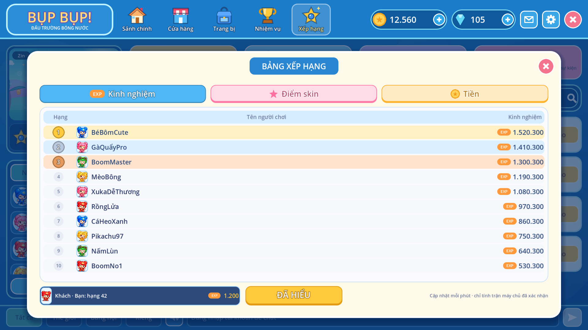

# Bảng xếp hạng

Ba bảng: **Kinh nghiệm**, **Điểm skin**, **Tiền**. Mọi giá trị do API tính từ dữ liệu của máy chủ;
client chỉ hiển thị (`apps/api/app/leaderboard.py`).

| Bảng              | Nguồn                                                                                       | Điểm mặc định                                                                 |
| ----------------- | ------------------------------------------------------------------------------------------- | ----------------------------------------------------------------------------- |
| Kinh nghiệm (EXP) | Trận arena đã xác minh (phòng online và luyện tập trên arena) và trận Đại Chiến Boss        | 20/trận, +50 thắng (hạng 1), +10/lần hạ đối thủ, 30/trận Boss, +60 thắng Boss |
| Điểm skin         | Đồ trang trí trong kho: `outfit`, `hat`, `wings`, `pet`, `bomb_skin`, `effect`, `accessory` | Thường 10, Hiếm 30, Epic 60, Huyền thoại 100 mỗi món                          |
| Tiền              | Số vàng trong ví (`wallets.gold`)                                                           | —                                                                             |

Trận do client tự báo (luyện tập offline, `verified = false`) không được tính. Chỉ người có điểm
lớn hơn 0 mới lên bảng. Người bằng điểm xếp theo tên. Ảnh đại diện là nhân vật dùng ở trận gần nhất
(mặc định Bombo).

## API

- `GET /v1/leaderboards?limit=1..100` (cần đăng nhập người chơi): `boards.{exp,skin,gold}` là top N
  (`rank`, `name`, `hero`, `value`); `me` là hạng, điểm của chính người gọi và cờ `hidden`.
  Không trả `account_id`. N không vượt quá `size` admin đặt.
- Admin (`/admin/v1`, quyền đọc để xem, quyền `liveops` để sửa; mọi thao tác ghi audit):
  - `GET /leaderboards?board=exp|skin|gold&q=&limit=`: bảng kèm `account_id`. Người bị ẩn vẫn
    hiện (rank `null`) để khôi phục.
  - `GET` / `PUT /leaderboards/settings`: trọng số EXP, điểm skin theo độ hiếm, `size` (5–100).
    Lưu trong `site_settings` (key `leaderboard`), không cần migration.
  - `GET /leaderboards/hidden`; `POST /leaderboards/hidden/{account_id}` `{reason}` ẩn khỏi mọi
    bảng; `DELETE /leaderboards/hidden/{account_id}` hiện lại.

## Giao diện

- **App PC:** nút **Xếp hạng** trên thanh trên mở `scripts/ui/pc/pc_leaderboard.gd`. Ba tab màu
  (EXP, Điểm skin, Tiền); mỗi tab chỉ hiện bảng của nó: top 10 (huy chương top 3) và hạng của
  bạn ở dưới, cạnh nút ĐÃ HIỂU. Trang tự tải lại mỗi phút khi đang mở. Khách thấy lời nhắc đăng nhập.
- **Admin:** trang **Xếp hạng** (`/admin/leaderboard/`) gồm ba tab bảng có tìm kiếm, nút ẩn/hiện
  (bắt buộc lý do), khung chỉnh cách tính điểm (có nút về mặc định) và danh sách người đang bị ẩn.

## Giới hạn

Điểm được tính lại mỗi lần đọc. Ở quy mô hiện tại việc này đủ nhanh; khi lượng người chơi lớn, nên
lưu bảng tạm (cache) vài phút. Cấp độ (`Lv.`) ở sảnh vẫn là hồ sơ demo phía client, chưa lấy từ EXP.

## Kiểm thử

`apps/api/tests/test_leaderboard.py` kiểm tra nguồn điểm, bỏ qua trận chưa xác minh và vật phẩm
tiêu hao, đổi trọng số, ẩn/hiện có audit và quyền truy cập. `apps/practice/tests/pc_screens.gd`
kiểm tra nút Xếp hạng, màn khách, top 10, mỗi tab chỉ hiện bảng của nó và nút ĐÃ HIỂU.
