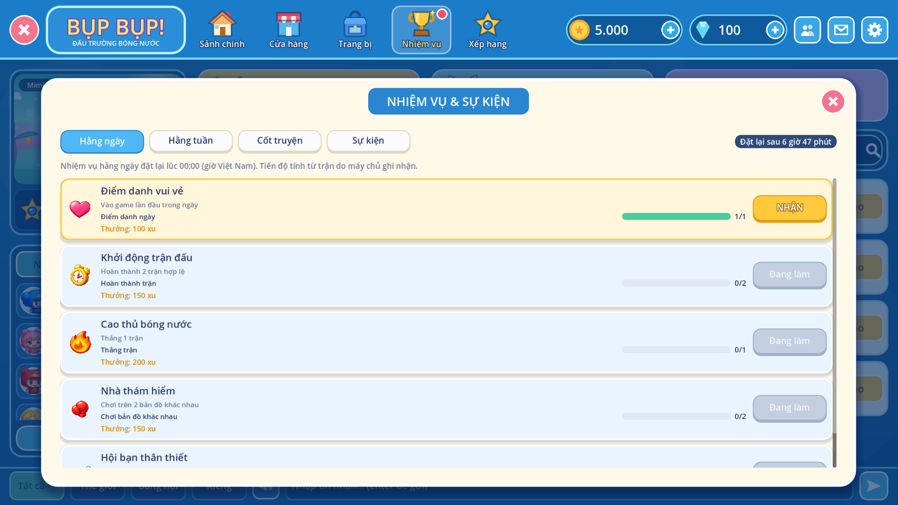
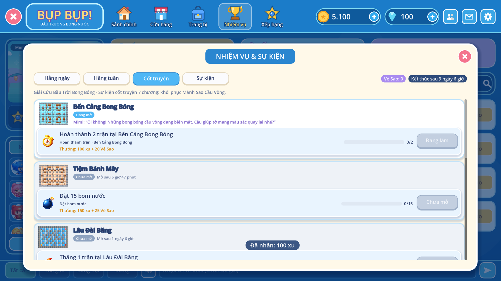
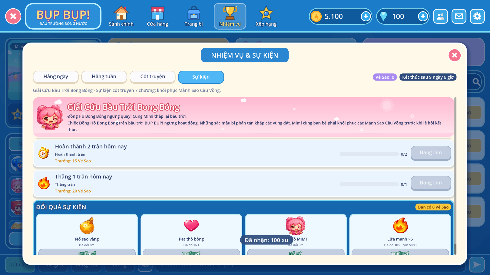

# Nhiệm vụ & sự kiện LiveOps

Triển khai theo `BUPBUP_Mission_Event_LiveOps_Dev_Spec.pdf` (v1.0): P1 (nhiệm vụ ngày/tuần,
nhận thưởng), P2 (trình tạo sự kiện), P3 (chuỗi chương, Vé sự kiện, Event Shop).
Code: `apps/api/app/liveops.py`, `apps/admin/src/pages/{quests,events}.tsx`,
`apps/practice/scripts/ui/pc/pc_missions.gd`. Bảng: `infra/postgres/008_liveops.sql`.

## Người chơi (app PC)

Tab **Nhiệm vụ** trên thanh trên mở cửa sổ 4 tab, chấm đỏ khi có thưởng chờ nhận (app hỏi
mỗi phút):

- **Hằng ngày / Hằng tuần**: thanh tiến độ từng điều kiện, phần thưởng, đếm ngược tới lúc
  đặt lại (00:00 giờ Việt Nam; tuần đặt lại thứ Hai).
- **Cốt truyện**: các chương (ảnh bản đồ, trạng thái Chưa mở / Đang mở / Hoàn thành, lời
  NPC). Chương mở theo ngày sự kiện và có thể cần xong chương trước.
- **Sự kiện**: banner, nhiệm vụ sự kiện (một lần hoặc mỗi ngày), số Vé, **Đổi quà sự kiện**.
- Nút **NHẬN** chỉ bật khi server báo hoàn thành; mỗi lần bấm gửi `request_id`, bấm lại hay
  nhận từ hai máy cùng lúc vẫn chỉ được thưởng một lần. Đếm ngược theo giờ server.
- Khách (không tài khoản) được nhắc đăng nhập.

## Tiến độ (chống gian lận)

- Chỉ tăng từ trận server ghi nhận (`matches.record_match`), mỗi (người, trận) một lần.
- Trận **online** (arena, đã xác thực) luôn được tính. Trận **Luyện tập** chỉ tính cho
  điều kiện admin bật chế độ “Luyện tập”; trận dưới 20 giây không tính, tối đa 40
  trận Luyện tập/ngày/người.
- Điều kiện hỗ trợ: `MATCH_COMPLETED`, `MATCH_WON`, `BOMB_PLACED`, `MAPS_DISTINCT`,
  `LOGIN_DAY` (mở cửa sổ Nhiệm vụ/sảnh lần đầu trong ngày), `WITH_FRIEND` (có bạn bè đã
  chấp nhận trong cùng trận online). Lọc theo id bản đồ (`harbor`, `moon`, bản đồ admin…).
  Một nhiệm vụ có tối đa 4 điều kiện, tất cả phải đạt.
- Arena gửi `map_id` trong kết quả trận; app gửi `map_id` và số bom ở trận Luyện tập.

## Admin

- **Nhiệm vụ** (`/admin/quests/`): bộ mặc định D01–D05, W01–W03 (nút “Thêm bộ mặc định”
  hoặc `python -m app.admin_cli seed-quests`), thêm/sửa/bật/tắt; thưởng xu, KC, vật phẩm.
- **Sự kiện** (`/admin/events/`), 6 bước: Thông tin (banner, cốt truyện, NPC, tên vé) →
  Lịch (bắt đầu, kết thúc, hạn nhận thưởng) → Chương → Nhiệm vụ (quest builder) → Event
  Shop (giá vé, tối đa/người, tồn kho) → Kiểm tra & lưu. “Tạo từ mẫu” nạp sự kiện mẫu
  “Giải Cứu Bầu Trời Bong Bóng” (7 chương, Vé Sao, 4 món đổi quà) với bản đồ thật.
- Server kiểm tra: lịch đúng thứ tự, mã không trùng, bản đồ/vật phẩm tồn tại và không ẩn,
  chương mở trước khi kết thúc, vật phẩm vĩnh viễn chỉ đổi 1 lần; cảnh báo kinh tế (số vé
  tối đa kiếm được so với giá món rẻ nhất, thưởng KC lớn).
- Vòng đời: Nháp → Phát hành (Đã lên lịch / Đang chạy / Đã kết thúc theo giờ) ⇄ Tạm dừng.
  Tạm dừng ẩn sự kiện và chặn nhận thưởng; sự kiện đang chạy phải tạm dừng mới sửa được.
  Mỗi lần phát hành/tiếp tục lưu một phiên bản bất biến (`event_versions`). Sau khi kết
  thúc không cộng tiến độ nhưng vẫn nhận thưởng tới hạn nhận.
- **Thống kê**: người tham gia, bắt đầu/hoàn thành/đã nhận theo nhiệm vụ (thấy chương bị
  bỏ dở), vé đã phát/đã tiêu, lượt đổi quà theo món, lịch sử phiên bản. Mọi thao tác có
  audit log.

## API

| HTTP | Đường dẫn                         | Mục đích                                     |
| ---- | --------------------------------- | -------------------------------------------- |
| GET  | `/v1/quests`                      | Toàn bộ dữ liệu cửa sổ Nhiệm vụ + giờ server |
| POST | `/v1/quests/{key}/claim`          | Nhận thưởng (`{request_id}`)                 |
| GET  | `/v1/events/active`               | Sự kiện đang hiện                            |
| POST | `/v1/events/{id}/shop/orders`     | Đổi quà (`{sku, request_id}`)                |
| PUT  | `/admin/v1/quests/{key}`          | Tạo/sửa nhiệm vụ ngày/tuần                   |
| POST | `/admin/v1/events/validate`       | Kiểm tra cấu hình sự kiện                    |
| GET  | `/admin/v1/events/template`       | Sự kiện mẫu                                  |
| GET  | `/admin/v1/events/{id}/analytics` | Thống kê                                     |

Chưa làm (giai đoạn sau): bước duyệt nhiều người (REVIEW), xếp hạng/mùa giải, mục tiêu cộng
đồng, nhân đôi cuối tuần, danh hiệu/biểu cảm (game chưa có loại vật phẩm này), hazard và
gameplay đặc biệt, thông báo đẩy.

## Kiểm thử

- `apps/api/tests/test_liveops.py`: tiến độ từ trận xác thực một lần, nhận thưởng
  idempotent, Luyện tập chỉ khi được bật, chương/vé/shop/thống kê, hạn nhận thưởng.
- `apps/practice/tests/missions.gd` (stack thật + admin thử): seed, phát hành sự kiện mẫu,
  chấm đỏ, nhận D01 qua nút, 3 tab còn lại. `tests/online.gd` xác nhận trận online thật
  cộng nhiệm vụ D02.

| Hằng ngày                                   | Cốt truyện                                  | Sự kiện & đổi quà                           |
| ------------------------------------------- | ------------------------------------------- | ------------------------------------------- |
|  |  |  |
