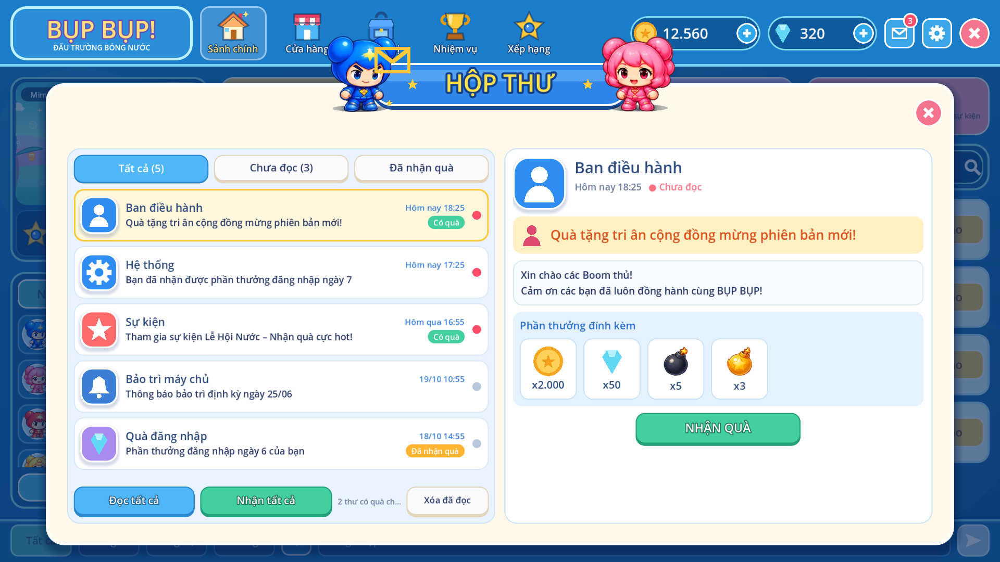

# Hộp thư

Admin gửi thư từ trang **Hộp thư** (`/admin/mail/`). Thư gửi được tới người chơi chỉ định hoặc toàn
server, kèm hoặc không kèm phần thưởng (vàng, kim cương, vật phẩm trong danh mục). Người chơi đọc và
nhận quà trong cửa sổ **HỘP THƯ** của app PC (nút thư trên thanh trên, có số thư chưa đọc).

## Quy tắc

- **Toàn server:** mọi tài khoản thấy thư, kể cả tài khoản tạo sau khi gửi, cho tới khi hết hạn
  (1–365 ngày, mặc định 30). Gửi một thư toàn server chỉ tạo một dòng trong database.
- **Người chơi chỉ định:** tối đa 200 người, tìm theo tên, tên đăng nhập hoặc ID.
- **Phần thưởng:** người chơi bấm **Nhận quà** thì quà mới vào ví / kho, và mỗi người chỉ nhận được một
  lần, kể cả khi bấm cùng lúc trên hai máy. Vàng và kim cương ghi vào sổ ví với loại `mail`. Vật phẩm
  tiêu hao cộng số lượng; vật phẩm trang trí thêm vào kho nếu chưa có.
- **Thu hồi:** thư bị ẩn với người chưa nhận quà, người đã nhận vẫn giữ quà. Phải nhập lý do.
- **Người chơi xóa thư:** thư còn quà chưa nhận thì không xóa được. Nút "Xóa đã đọc" xóa các thư đã
  đọc và đã nhận hết quà.
- Gửi và thu hồi đều ghi nhật ký audit (`mail.send`, `mail.recall`).

## API

Người chơi (cần đăng nhập):

- `GET /v1/mail`: thư còn hiệu lực, số `unread` và `claimable`.
- `POST /v1/mail/{id}/read`, `POST /v1/mail/read-all`.
- `POST /v1/mail/{id}/claim` (đã nhận rồi trả 409), `POST /v1/mail/claim-all`.
- `DELETE /v1/mail/{id}`, `POST /v1/mail/delete-read`.

Admin (`/admin/v1`, quyền đọc để xem, quyền `liveops` để gửi và thu hồi):

- `GET /mail?q=`: thư đã gửi, kèm số người đã đọc và đã nhận.
- `POST /mail` `{title, body, category, sender, audience: all|players, targets, rewards, expires_days}`.
- `POST /mail/{id}/recall` `{reason}`.
- `GET /mail/players?q=`: tìm người nhận.

`category` là một trong `admin`, `system`, `event`, `maintenance`, `reward`; nó quyết định biểu tượng
trong game.

## Cài đặt trên database đang chạy

```bash
docker compose exec -T postgres psql -U suni -d suni < infra/postgres/015_mail.sql
```

## Kiểm thử

- `apps/api/tests/test_mail.py`: gửi toàn server (kể cả tài khoản tạo sau), nhận quà một lần, nhận tất
  cả, gửi chỉ định, đọc, xóa, thu hồi, quyền và audit.
- `apps/practice/tests/mail.gd`: nút thư, màn khách, danh sách, tab lọc, đánh dấu đã đọc, số trên nút
  thư, nút Nhận quà.


