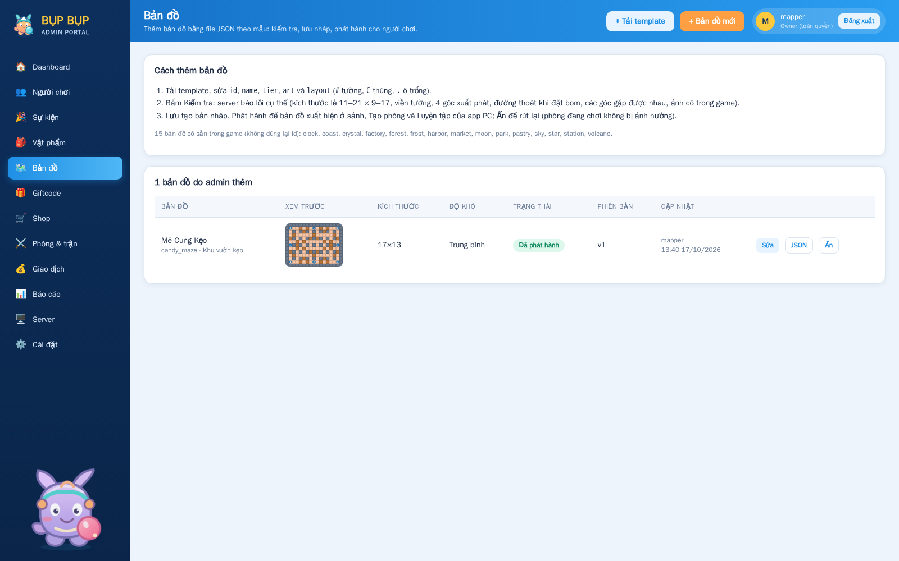
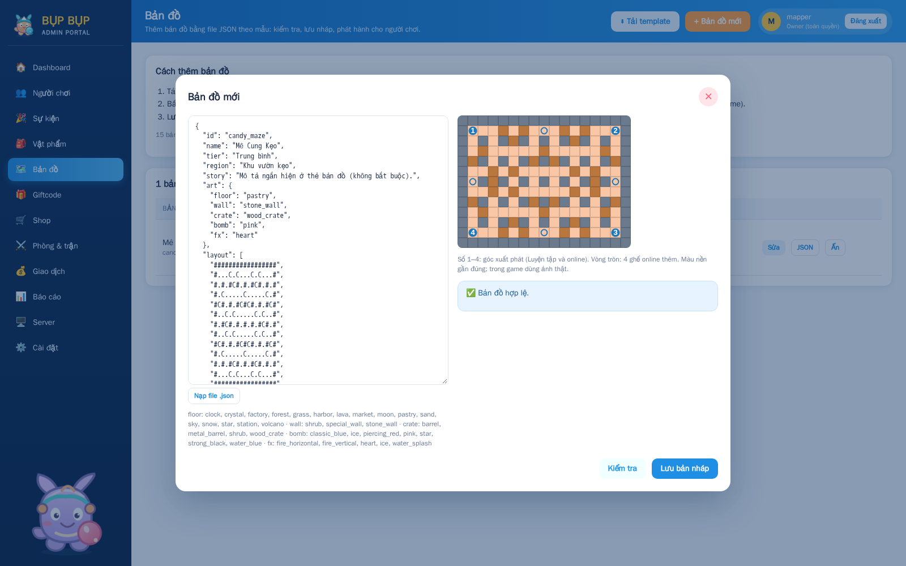
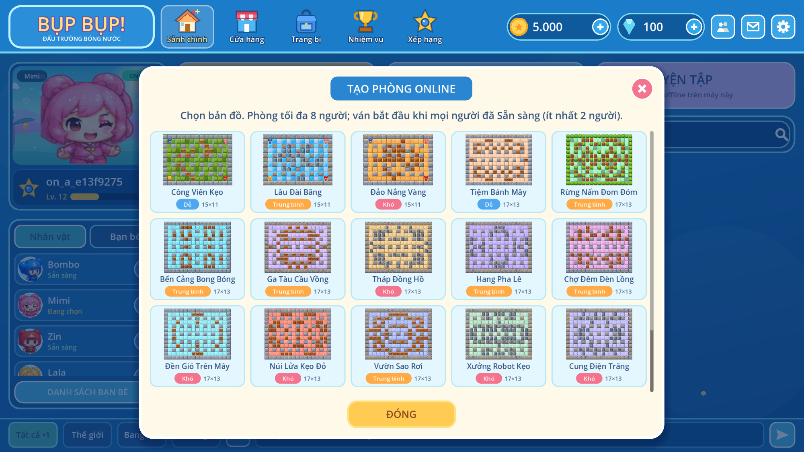
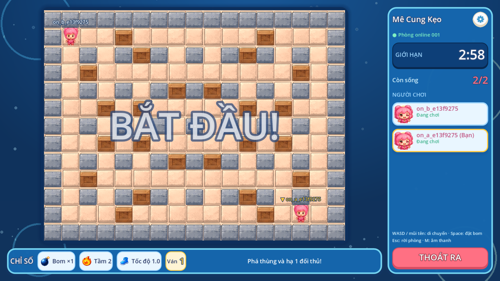
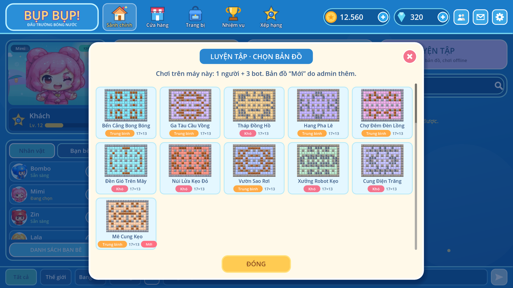
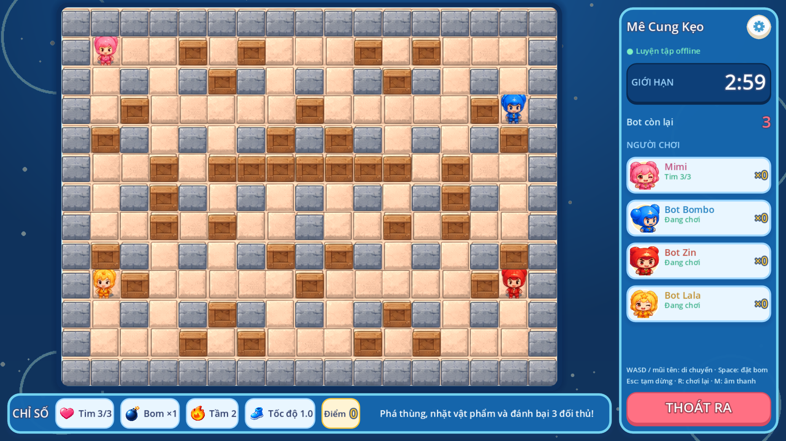

# Bản đồ do admin thêm

Admin thêm bản đồ mới mà không cần build lại game: khai báo bằng một file JSON theo
mẫu [map-template.json](map-template.json), kiểm tra, lưu nháp rồi phát hành ở trang
**Admin → Bản đồ** (`/admin/maps/`). App PC tải danh sách bản đồ đã phát hành
(`GET /v1/maps`) và gộp với 15 bản đồ có sẵn: sảnh (bộ lọc, thẻ phòng, hộp **Tạo
phòng**), **Tìm trận nhanh** và **Luyện tập**. Server arena mở phòng online trên bản đồ
đó và tự kiểm tra lại layout trước khi dựng phòng.

## Template

```json
{
  "id": "candy_maze",
  "name": "Mê Cung Kẹo",
  "tier": "Trung bình",
  "region": "Khu vườn kẹo",
  "story": "Mô tả ngắn hiện ở thẻ bản đồ (không bắt buộc).",
  "art": {
    "floor": "pastry",
    "wall": "stone_wall",
    "crate": "wood_crate",
    "bomb": "pink",
    "fx": "heart"
  },
  "layout": ["#################", "#...C.C...C.C...#", "…", "#################"]
}
```

| Trường   | Bắt buộc | Quy tắc                                                                                                                   |
| -------- | -------- | ------------------------------------------------------------------------------------------------------------------------- |
| `id`     | Có       | 3–24 ký tự `a-z 0-9 _`, bắt đầu bằng chữ; không trùng 15 bản đồ có sẵn; không đổi sau khi tạo.                            |
| `name`   | Có       | 2–40 ký tự, hiển thị trên thẻ.                                                                                            |
| `tier`   | Có       | `Dễ`, `Trung bình` hoặc `Khó` (bộ lọc độ khó và tốc độ bot ở Luyện tập).                                                  |
| `region` | Không    | ≤ 60 ký tự, hiện sau độ khó (“Trung bình • Khu vườn kẹo”).                                                                |
| `story`  | Không    | ≤ 300 ký tự, hiện khi rê chuột lên thẻ bản đồ.                                                                            |
| `art.*`  | Có       | Chỉ dùng ảnh có trong game, xem danh sách bên dưới (trang admin cũng in danh sách).                                       |
| `layout` | Có       | Mảng chuỗi bằng nhau, `#` tường, `C` thùng phá được, `.` ô trống. Rộng 11–21 cột, cao 9–17 hàng, **cả hai đều là số lẻ**. |

Ảnh hợp lệ:

- `floor`: grass, sand, snow, lava, pastry, forest, harbor, station, clock, crystal,
  market, sky, volcano, star, factory, moon
- `wall`: stone_wall, special_wall, shrub
- `crate`: wood_crate, barrel, metal_barrel, shrub
- `bomb`: classic_blue, ice, piercing_red, pink, star, strong_black, water_blue
- `fx`: water_splash, ice, fire_horizontal, fire_vertical, heart

## Server kiểm tra gì

- **Lỗi** (không lưu được):
  - Kích thước, ký tự lạ, hàng dài khác nhau.
  - Viền ngoài không phải toàn `#`.
  - 4 góc xuất phát `(1,1)`, `(w-2,1)`, `(w-2,h-2)`, `(1,h-2)` không phải `.`.
  - 4 ghế online thêm (giữa mỗi cạnh) là tường.
  - Một góc không có đường thoát khi đặt quả bom đầu tiên (tại chỗ hoặc ô kề, tầm nổ 2).
  - Các góc bị tường chia cắt.
  - Ảnh không có trong game.
- **Cảnh báo** (vẫn lưu):
  - Thùng sát 4 góc (trong 2 ô) được dọn tự động, giống luật của server.
  - Bản đồ quá ít thùng.

Luật chơi giống các bản đồ Classic: 1 bom, tầm nổ 2, 8 ghế online (4 góc + 4 điểm giữa
cạnh), Luyện tập 1 người + 3 bot ở 4 góc. Chưa hỗ trợ hazard riêng hoặc ảnh tile mới:
ảnh nền/tường/thùng phải chọn từ danh sách trên.

## Vòng đời

1. **Kiểm tra** (`POST /admin/v1/maps/validate`): trả `ok`, `errors`, `warnings` và
   layout sau khi dọn góc; trang admin vẽ xem trước (số 1–4 là góc xuất phát).
2. **Lưu bản nháp** (`POST /admin/v1/maps`, vai trò có quyền liveops). Sửa bằng
   `PUT /admin/v1/maps/{id}` (tăng `revision`).
3. **Phát hành / Ẩn** (`POST /admin/v1/maps/{id}/publish|hide`), có nhật ký audit.
4. App PC hỏi `GET /v1/maps` (ETag) khi mở, rồi tự hỏi lại mỗi 30 giây và khi mở hộp
   **Tạo phòng** / **Luyện tập** hoặc thấy phòng trên bản đồ lạ: bản đồ vừa phát hành hiện
   trong vòng khoảng 30 giây mà không cần mở lại app. Arena cache danh sách 15 giây; phòng đang chơi
   giữ bản đồ lúc tạo phòng.

Bảng `game_maps`: [infra/postgres/007_maps.sql](../infra/postgres/007_maps.sql).
Code: `apps/api/app/maps.py`, `apps/arena/src/maps.ts` (`findMap`),
`apps/practice/scripts/map_catalog.gd`, `apps/admin/src/pages/maps.tsx`.

## Ảnh

| Admin: danh sách                                         | Admin: soạn và kiểm tra                             |
| -------------------------------------------------------- | --------------------------------------------------- |
|                |     |
| **App PC: Tạo phòng (map mới ở cuối)**                   | **App PC: trận online trên map admin**              |
|  |  |

**Luyện tập**: nút **LUYỆN TẬP** ở sảnh mở lưới chọn bản đồ (bản đồ admin có nhãn “Mới”),
chọn xong vào phòng 1 người + 3 bot trên bản đồ đó.

| Luyện tập: chọn bản đồ                                     | Luyện tập trên bản đồ admin                           |
| ---------------------------------------------------------- | ----------------------------------------------------- |
|  |  |
