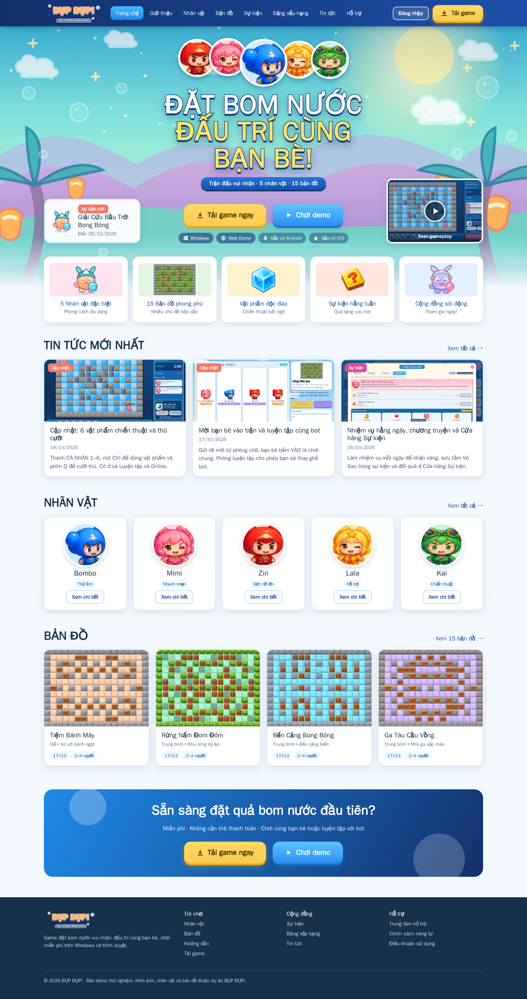
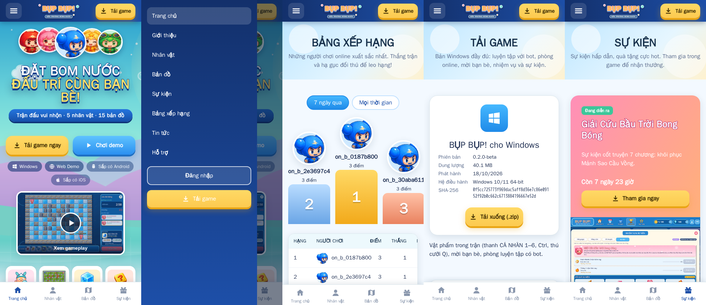
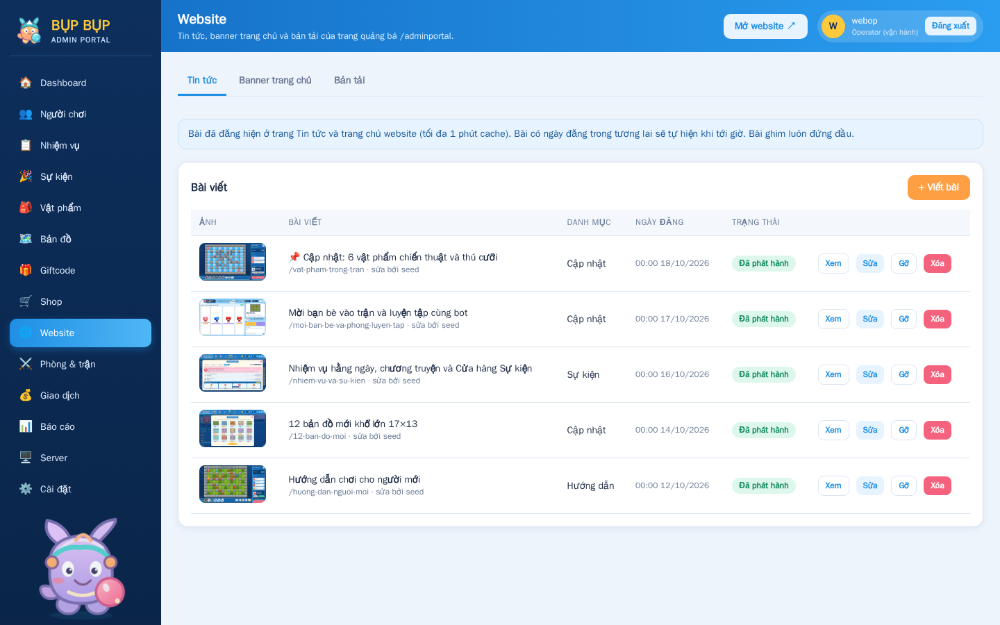

# Website quảng bá (`/`)

Trang công khai để quảng cáo game: <https://boom.sunifactory.com/>. Bố cục theo
`Game_Boom_Website_Portal_Dev_Spec` và ảnh mẫu, nhưng dùng thương hiệu và hình ảnh của
chính game (**BỤP BỤP!**, nhân vật, bản đồ, icon vật phẩm, ảnh chụp trận thật).




## Trang

| Đường dẫn              | Nội dung                                                        | Dữ liệu                                 |
| ---------------------- | --------------------------------------------------------------- | --------------------------------------- |
| `/`                    | Hero, Tải game / Chơi demo, ảnh gameplay, tin, nhân vật, bản đồ | `GET /api/v1/public/site`, tin, sự kiện |
| `about/`               | Giới thiệu luật chơi, chế độ, vật phẩm                          | tĩnh                                    |
| `characters/`, `maps/` | 5 nhân vật (chỉ số), 15 bản đồ + bản đồ admin xuất bản, bộ lọc  | `data/game.json`, `GET /api/v1/maps`    |
| `events/`              | Sự kiện đang/sắp/đã diễn ra, đếm ngược, cách nhận quà           | `GET /api/v1/public/events`             |
| `rankings/`            | Bục top 3 + bảng 50 người, 7 ngày / mọi thời gian               | `GET /api/v1/public/rankings`           |
| `news/`, `news/post/`  | Tin tức (ghim, danh mục), bài viết `?slug=`                     | `GET /api/v1/public/news[/{slug}]`      |
| `download/`            | Bản Windows: phiên bản, dung lượng, ngày, SHA-256, cách cài     | `/releases/latest.json`                 |
| `guide/`, `support/`   | Phím, 6 vật phẩm, mẹo; câu hỏi thường gặp                       | `data/game.json`                        |
| `privacy/`, `terms/`   | Chính sách, điều khoản; `404.html` riêng                        | tĩnh                                    |

“Chơi demo” và “Đăng nhập” mở bản web chơi thử `/demo/` (`apps/web/public/demo`); từ đó
nút “Chơi với bot” mở `/practice/`. Link cũ `/adminportal/...` chuyển hướng 301 về `/...`.
Nguồn trang: `apps/web/public` (trừ `demo/`, `practice/`), ảnh game chép vào `/assets/`
lúc build image.

## API công khai (`apps/api/app/portal.py`)

Không cần đăng nhập, chỉ đọc, `Cache-Control: public, max-age=60`, không lộ id tài khoản.

- `GET /v1/public/events`: sự kiện đã xuất bản, `status` = `live` / `upcoming` / `ended`
  (kết thúc ≤30 ngày).
- `GET /v1/public/rankings?period=week|all&limit=1..50`: trận online đã xác minh, không
  có bot; 3 điểm/thắng + 1 điểm/hạ gục.
- `GET /v1/public/news?category=&limit=1..100`, `GET /v1/public/news/{slug}`: bài đã đăng
  và đã tới ngày đăng, ghim trước (`apps/api/app/website.py`). Nếu API lỗi, site đọc
  `data/news.json` (bản sao tĩnh); 404 nghĩa là bài đã gỡ.
- `GET /v1/public/site`: chữ của hero (tiêu đề, tiêu đề phụ, ruy băng, 2 nút). HTML tĩnh
  đã có chữ mặc định, API chỉ thay khi tải được.

## Cập nhật nội dung

### Admin Portal → Website (không cần build lại)



- **Tin tức**: viết / sửa / đăng / gỡ / xóa bài; slug, danh mục (Cập nhật, Sự kiện,
  Hướng dẫn), tóm tắt, nội dung chữ thuần (cách đoạn bằng dòng trống), ảnh bìa (ảnh có sẵn
  `img/*.webp` hoặc tải PNG lên kho ảnh chung với icon vật phẩm), ghim, ngày đăng (ngày
  tương lai = lên lịch).
- **Banner trang chủ**: tiêu đề, tiêu đề phụ, ruy băng, chữ 2 nút; có xem trước.
- **Bản tải**: chỉ xem `latest.json`, `history.json` và các ZIP trong `RELEASES_DIR`
  (API mount chỉ đọc). Phát hành vẫn bằng script bên dưới.

Operator/owner sửa được, viewer chỉ xem; mọi thao tác ghi vào audit log (`website.*`).
Nội dung là chữ thuần: API bỏ ký tự điều khiển/bidi, site chỉ gán bằng `textContent`,
ảnh chỉ nhận đường dẫn `/img/*.webp` hoặc `/api/v1/assets/<sha256>.png`.
Bảng `site_news`, `site_settings`: `infra/postgres/011_website.sql` (chèn sẵn 5 bài cũ của
`news.json`). Volume cũ chạy một lần:

```bash
docker compose exec -T postgres psql -U suni -d suni < infra/postgres/011_website.sql
```

### Script

```bash
python3 scripts/build-portal.py          # nhân vật, bản đồ, vật phẩm từ file của game
python3 scripts/publish-release.py build/practice/suni-bot-arena-windows-x86_64.zip \
  --version 0.2.0-beta --notes "Ghi chú phát hành"
```

`publish-release.py` chép ZIP vào `build/releases/` (đổi bằng `RELEASES_DIR`) và ghi
`latest.json` và nối thêm `history.json`; nginx phục vụ thư mục này tại `/releases/` (mount
chỉ đọc), nên đổi bản tải **không cần build lại image**. File cũ được giữ để quay lại.
`data/news.json` chỉ còn là bản dự phòng khi API lỗi.

## Bảo mật và hiệu năng

- CSP chỉ `'self'`, không có script/style inline; dữ liệu API chỉ gán bằng `textContent`.
- Ảnh gameplay WebP ~100 KB, ảnh ngoài màn đầu `loading="lazy"`; tôn trọng
  `prefers-reduced-motion`; nút ≥44 px, focus bàn phím, menu đóng bằng Esc.
- Không có tracking/analytics và cookie.

## Chưa làm (theo spec P1/P2)

Phát hành bản tải từ Admin Portal (vẫn bằng script), giftcode, trang tài khoản,
analytics/UTM, sitemap/robots riêng, trailer video.
