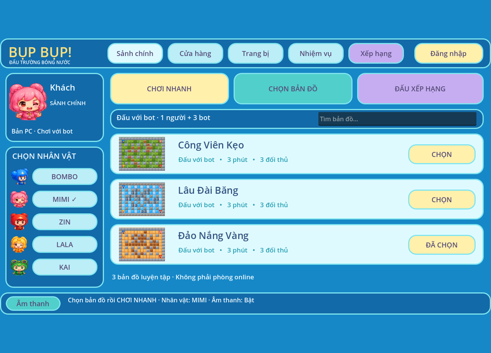

# Chơi với bot — Step 3

Mở `/practice/` từ nút **Chơi với bot** trên website. Không cần tài khoản.
Màn đầu là **Cửa hàng** demo; chọn **Trang bị** để thử loadout hoặc **Vào trận**
để chọn nhân vật/bản đồ. Xem [UI PC/Web](UI_SHOP_EQUIPMENT.md).
Bản Windows riêng: giải nén ZIP `suni-bot-arena-windows-x86_64.zip`, chạy
`suni-bot-arena.exe`, không cần cài Godot.

- Chọn Bombo, Mimi, Zin, Lala hoặc Kai; 120 PNG di chuyển, 6 frame/hướng, 12 FPS.
- Ba bản đồ: Công Viên Kẹo, Lâu Đài Băng, Đảo Nắng Vàng.
- Người chơi 3 tim, 3 bot mỗi bot 1 tim; ván tối đa 180 giây.
- Bom ngòi 2,4 giây, nổ dây chuyền, thùng phá được; vật phẩm thêm bom, tầm nổ,
  tốc độ. Miễn sát thương 1,65 giây sau khi trúng bom.
- Bot dự báo vùng nổ và thời điểm kích nổ dây chuyền, BFS tìm đường thoát,
  kiểm tra đường rút trước khi đặt bom, tìm vật phẩm/thùng/đối thủ.
- 11 WAV synth gốc theo README nguồn, gồm nhạc nền 8 giây và hiệu ứng.

WASD/mũi tên di chuyển; Space đặt bom; M bật/tắt nhạc và hiệu ứng;
Esc tạm dừng; R chơi lại. Dùng bàn phím máy tính. Click vào sân nếu trình duyệt
chưa nhận phím. Chọn **Toàn màn hình** để phóng to.

Đây là chế độ chơi đơn cục bộ chạy Godot trên web/Windows, không gửi điểm,
tọa độ hoặc thắng thua lên server. Chế độ online hiện có giữ nguyên luật và
phản hồi di chuyển; tài khoản, phòng và trận online không bị đổi thành trận bot.

## Nguồn và build

Source và assets từ ZIP `Game_Boom_Step3_Godot.zip` do người dùng cung cấp,
ở `apps/practice`. Giữ README nguồn và hash tài nguyên trong PROVENANCE.json.
Các frame bổ sung là biến đổi từ pose gốc, không phải 120 hình vẽ độc lập.
Sửa runtime: hủy tween cũ khi tăng tốc, xử lý hết chuỗi nổ trước kết quả,
tránh đường BFS qua lửa và dự báo ngòi nổ dây chuyền.
Phím R bắt đầu ván mới cả khi đang chơi, tạm dừng hoặc đã kết thúc.
HUD dùng chữ/số cho tim và hướng dẫn phím để tránh ký tự thiếu trong font web.

Dùng Godot 4.4.1 và export templates cùng phiên bản gồm
`web_nothreads_release.zip`, `windows_release_x86_64.exe` tại
`build/godot-data/godot/export_templates/4.4.1.stable/`.

```bash
GODOT=/path/to/godot python3 scripts/build-practice.py
# Chỉ cần web: thêm --web-only. Cài templates bằng:
# bash scripts/install-godot-templates.sh
# Export web phải có trước khi build image web:
docker build -f apps/web/Dockerfile -t suni-web:step3 .
godot --headless --path apps/practice --script res://tests/headless_smoke.gd
godot --headless --path apps/practice --script res://tests/gameplay.gd
python3 apps/practice/tools/verify_step3.py
```

Web export một luồng, không cần SharedArrayBuffer/COOP/COEP. Nginx cho phép
WebAssembly trong riêng đường dẫn engine; loader được tách JS/CSS ngoài,
không bật `unsafe-eval` hoặc inline script. File export và Windows ZIP không
đưa vào Git; build có commit và cờ dirty trong BUILD.json.

## Kiểm thử local — 2026-10-15

- Godot 4.4.1: smoke qua cả ba bản đồ; 127 kiểm tra gameplay đạt, gồm
  va chạm, giới hạn bom, nổ dây chuyền, chết đồng thời, AI tìm đường thoát,
  vật phẩm, hết giờ, âm thanh và chơi lại sau khi kết thúc/tạm dừng.
- Kiểm tra tĩnh: ba bản đồ, 120 frame, 11 WAV và hash tài nguyên đạt.
- Export Web và Windows thành công. Chưa chạy executable trên máy Windows.
- Node 22.23.3: lint, build, 15 arena tests và 9 web tests đạt.
- Python 3.12 trong Docker: Ruff lint/format và 21 API tests đạt;
  còn cảnh báo deprecation Starlette/httpx.
- Web multiplayer smoke qua Nginx trên stack kiểm thử riêng đạt.
- Chromium: cả bốn kịch bản browser đạt, gồm desktop/mobile online và tải
  Godot, chọn Kai/bản đồ đảo, di chuyển/đặt bom, tạm dừng, âm thanh, chơi lại.
  Ảnh: [menu](screenshots/step3/menu.png),
  [gameplay](screenshots/step3/gameplay.png), [tạm dừng](screenshots/step3/paused.png).

Các kết quả này là kiểm thử local, không thay thế kết quả GitHub Actions.

## Launch trên PC

Bản Windows mở màn hình Launch đảo bóng nước trước tiên. Chọn **Chơi thử**
(1P) để vào sảnh chính PC hoặc **Cửa hàng / Trang bị** để xem bộ UI hiện có.
Từ sảnh, Cửa hàng/Trang bị mở đúng tab và Trang chủ quay lại sảnh. Nếu mở cửa hàng từ Launch trước khi vào sảnh, Trang chủ quay lại Launch. Đăng nhập/đăng ký gọi API thật; thành công mở sảnh PC.
Điểm số, tiền và trang bị demo chưa đồng bộ tài khoản trên server.
Nhớ tên đăng nhập chỉ lưu tên, không lưu mật khẩu/token. 2P chưa hỗ trợ.

Build riêng PC: `GODOT=/path/to/godot python3 scripts/build-practice.py --windows-only`.
Chạy `build/practice/suni-bot-arena-windows-x86_64/suni-bot-arena.exe`, giữ
file `.pck` cùng thư mục; ZIP cùng tên nằm tại `build/practice`.

### Tài khoản trên PC

Trong **Cài đặt**, nhập API tài khoản rồi **Áp dụng**. Mặc định loopback
`http://127.0.0.1:8000`; để dùng máy chủ hiện có, nhập
`https://api.sunifactory.com`. Có thể đặt `SUNI_API_URL` trước khi mở app.
Máy chủ từ xa yêu cầu HTTPS; cấu hình được lưu trong thư mục user của Godot.

Chọn **Đăng ký** để tạo tài khoản (tên 3–24 ký tự a-z, 0-9, _;
mật khẩu 10–128 ký tự và nhập lại). Chọn lại nút này để về Đăng nhập.
Đăng nhập chỉ chuyển sang sảnh PC sau khi API xác nhận. Trong lúc chờ,
form bị khóa; lỗi tài khoản/mạng hiển thị thông báo và cho phép thử lại.
Phiên chỉ nằm trong RAM, hết hạn theo API; đổi server hoặc Đăng xuất xóa phiên.
Quên mật khẩu chưa được backend hỗ trợ. Chơi thử xóa phiên và chơi offline.

Kiểm thử local: `godot --headless --path apps/practice --script res://tests/auth.gd`.
Test này tạo tài khoản ngẫu nhiên trên API local, không chạy trên production.

### Nếu đăng nhập báo hết thời gian kết nối

Mở **Cài đặt → Máy chủ tài khoản → Máy chủ Bụp Bụp → Kiểm tra**.
Khi báo kết nối thành công, nhấn **Áp dụng**, rồi thử đăng nhập/đăng ký.
`127.0.0.1` trỏ về chính PC đang chạy game, chỉ dùng nếu PC đó có API local.
Lỗi kết nối hiển thị URL đang gọi. Kiểm tra `/health` không gửi mật khẩu.
Nếu trình duyệt vào được API nhưng nút Kiểm tra trong game thất bại, gửi lại
thông báo đó để kiểm tra DNS/TLS hoặc quyền truy cập mạng của ứng dụng.

### Sảnh chính PC mới

Source app trong ảnh “Bụp Bụp! — Chơi với bot” là `apps/practice`,
khác client multiplayer `apps/client`. Bản PC mới thay menu chọn nhân vật cũ
bằng sảnh xanh, hồ sơ tài khoản/khách, năm nhân vật, ba thẻ bản đồ,
tìm bản đồ, Chơi nhanh, Cửa hàng, Trang bị và đăng xuất.
Thẻ bản đồ là trận bot local; không giả làm phòng online.
Nhiệm vụ và xếp hạng thông báo chưa hỗ trợ.
Web giữ scene khởi động riêng và menu chọn nhân vật cũ bằng feature `web`.



Kiểm thử Godot 4.4.1 local: `tests/desktop_lobby.gd`, `tests/auth.gd`,
`tests/gameplay.gd` (127 checks). Ảnh được chụp trực tiếp bằng Godot/Xvfb.
Chưa chạy executable trên Windows thật; export Windows không ký số.
