# Chơi với bot — Step 3

Mở `/practice/` từ nút **Chơi với bot** trên website. Không cần tài khoản.
Màn đầu là **Cửa hàng** demo; chọn **Trang bị** để thử loadout hoặc **Vào trận**
để chọn nhân vật/bản đồ. Xem [UI PC/Web](UI_SHOP_EQUIPMENT.md).
Bản Windows riêng: giải nén ZIP `suni-bot-arena-windows-x86_64.zip`, chạy
`suni-bot-arena.exe`, không cần cài Godot.

- Chọn Bombo, Mimi, Zin, Lala hoặc Kai; 120 PNG di chuyển, 6 frame/hướng, 12 FPS.
- Ba bản đồ: Công Viên Kẹo, Lâu Đài Băng, Đảo Nắng Vàng.
- Người chơi 3 tim, 3 bot mỗi bot 1 tim; ván tối đa 180 giây.
- Bom ngòi 2,4 giây, nổ dây chuyền, thùng phá được; vật phẩm thêm bom, tầm nổ,
  tốc độ. Miễn sát thương 1,65 giây sau khi trúng bom.
- Bot dự báo vùng nổ và thời điểm kích nổ dây chuyền, BFS tìm đường thoát,
  kiểm tra đường rút trước khi đặt bom, tìm vật phẩm/thùng/đối thủ.
- 11 WAV synth gốc theo README nguồn, gồm nhạc nền 8 giây và hiệu ứng.

WASD/mũi tên di chuyển; Space đặt bom; M bật/tắt nhạc và hiệu ứng;
Esc tạm dừng; R chơi lại. Dùng bàn phím máy tính. Click vào sân nếu trình duyệt
chưa nhận phím. Chọn **Toàn màn hình** để phóng to.

Đây là chế độ chơi đơn cục bộ chạy Godot trên web/Windows, không gửi điểm,
tọa độ hoặc thắng thua lên server. Chế độ online hiện có giữ nguyên luật và
phản hồi di chuyển; tài khoản, phòng và trận online không bị đổi thành trận bot.

## Nguồn và build

Source và assets từ ZIP `Game_Boom_Step3_Godot.zip` do người dùng cung cấp,
ở `apps/practice`. Giữ README nguồn và hash tài nguyên trong PROVENANCE.json.
Các frame bổ sung là biến đổi từ pose gốc, không phải 120 hình vẽ độc lập.
Sửa runtime: hủy tween cũ khi tăng tốc, xử lý hết chuỗi nổ trước kết quả,
tránh đường BFS qua lửa và dự báo ngòi nổ dây chuyền.
Phím R bắt đầu ván mới cả khi đang chơi, tạm dừng hoặc đã kết thúc.
HUD dùng chữ/số cho tim và hướng dẫn phím để tránh ký tự thiếu trong font web.

Dùng Godot 4.4.1 và export templates cùng phiên bản gồm
`web_nothreads_release.zip`, `windows_release_x86_64.exe` tại
`build/godot-data/godot/export_templates/4.4.1.stable/`.

```bash
GODOT=/path/to/godot python3 scripts/build-practice.py
# Chỉ cần web: thêm --web-only. Cài templates bằng:
# bash scripts/install-godot-templates.sh
# Export web phải có trước khi build image web:
docker build -f apps/web/Dockerfile -t suni-web:step3 .
godot --headless --path apps/practice --script res://tests/headless_smoke.gd
godot --headless --path apps/practice --script res://tests/gameplay.gd
python3 apps/practice/tools/verify_step3.py
```

Web export một luồng, không cần SharedArrayBuffer/COOP/COEP. Nginx cho phép
WebAssembly trong riêng đường dẫn engine; loader được tách JS/CSS ngoài,
không bật `unsafe-eval` hoặc inline script. File export và Windows ZIP không
đưa vào Git; build có commit và cờ dirty trong BUILD.json.

## Kiểm thử local — 2026-10-15

- Godot 4.4.1: smoke qua cả ba bản đồ; 127 kiểm tra gameplay đạt, gồm
  va chạm, giới hạn bom, nổ dây chuyền, chết đồng thời, AI tìm đường thoát,
  vật phẩm, hết giờ, âm thanh và chơi lại sau khi kết thúc/tạm dừng.
- Kiểm tra tĩnh: ba bản đồ, 120 frame, 11 WAV và hash tài nguyên đạt.
- Export Web và Windows thành công. Chưa chạy executable trên máy Windows.
- Node 22.23.3: lint, build, 15 arena tests và 9 web tests đạt.
- Python 3.12 trong Docker: Ruff lint/format và 21 API tests đạt;
  còn cảnh báo deprecation Starlette/httpx.
- Web multiplayer smoke qua Nginx trên stack kiểm thử riêng đạt.
- Chromium: cả bốn kịch bản browser đạt, gồm desktop/mobile online và tải
  Godot, chọn Kai/bản đồ đảo, di chuyển/đặt bom, tạm dừng, âm thanh, chơi lại.
  Ảnh: [menu](screenshots/step3/menu.png),
  [gameplay](screenshots/step3/gameplay.png), [tạm dừng](screenshots/step3/paused.png).

Các kết quả này là kiểm thử local, không thay thế kết quả GitHub Actions.

## Launch trên PC

Bản Windows mở toàn màn hình (`display/window/size/mode=3`; web giữ cửa sổ
qua `mode.web=0`). Tắt toàn màn hình trong Cài đặt của màn hình Launch.
Bản Windows mở màn hình Launch đảo bóng nước trước tiên. Chọn **Chơi thử**
(1P) để vào sảnh chính PC. Nút **Cửa hàng / Trang bị** trên Launch chỉ hiện khi
đã đăng nhập. Từ sảnh, Cửa hàng/Trang bị mở dạng popup ngay trên sảnh; nút ✕,
Esc, bấm ra ngoài hoặc tab Sảnh chính đóng popup. Đăng nhập/đăng ký gọi API
thật; thành công mở sảnh PC.
Điểm số, tiền và trang bị demo chưa đồng bộ tài khoản trên server.
Nhớ tên đăng nhập chỉ lưu tên, không lưu mật khẩu/token. 2P chưa hỗ trợ.

Build riêng PC: `GODOT=/path/to/godot python3 scripts/build-practice.py --windows-only`.
Chạy `build/practice/suni-bot-arena-windows-x86_64/suni-bot-arena.exe`, giữ
file `.pck` cùng thư mục; ZIP cùng tên nằm tại `build/practice`.

### Tài khoản trên PC

Trong **Cài đặt**, nhập API tài khoản rồi **Áp dụng**. Mặc định loopback
`http://127.0.0.1:8000`; để dùng máy chủ hiện có, nhập
`https://api.sunifactory.com`. Có thể đặt `SUNI_API_URL` trước khi mở app.
Máy chủ từ xa yêu cầu HTTPS; cấu hình được lưu trong thư mục user của Godot.

Chọn **Đăng ký** để tạo tài khoản (tên 3–24 ký tự a-z, 0-9, \_;
mật khẩu 10–128 ký tự và nhập lại, email để lấy lại mật khẩu). Chọn lại nút
này để về Đăng nhập.
Đăng nhập chỉ chuyển sang sảnh PC sau khi API xác nhận. Trong lúc chờ,
form bị khóa; lỗi tài khoản/mạng hiển thị thông báo và cho phép thử lại.
Phiên chỉ nằm trong RAM, hết hạn theo API; đổi server hoặc Đăng xuất xóa phiên.

- **Quên mật khẩu?** (dưới ô mật khẩu): nhập email đã đăng ký, API gửi mã 6 số
  (hiệu lực 15 phút, sai 5 lần thì hủy mã, mỗi phút gửi lại được một lần), rồi
  nhập mã và mật khẩu mới (`POST /v1/password/forgot`, `/v1/password/reset`).
  Tài khoản tạo trước khi có ô email không lấy lại mật khẩu được.
- **Đổi mật khẩu** (thanh dưới cùng): nhập tên, mật khẩu hiện tại và mật khẩu
  mới hai lần (`POST /v1/password`).

Gửi email do API cấu hình qua `.env`: `MAIL_MODE=smtp` với `SMTP_HOST`,
`SMTP_PORT`, `SMTP_USER`, `SMTP_PASSWORD`, `MAIL_FROM` (Gmail: `smtp.gmail.com`,
cổng 587, dùng App Password). `MAIL_MODE=log` chỉ để thử local: mã in trong
`docker compose logs api`. Mặc định `disabled` thì Quên mật khẩu báo chưa gửi được.

Chơi thử xóa phiên và chơi offline.

Kiểm thử local: `godot --headless --path apps/practice --script res://tests/auth.gd`.
Test này tạo tài khoản ngẫu nhiên trên API local, không chạy trên production.

### Nếu đăng nhập báo hết thời gian kết nối

Mở **Cài đặt → Máy chủ tài khoản → Máy chủ Bụp Bụp → Kiểm tra**.
Khi báo kết nối thành công, nhấn **Áp dụng**, rồi thử đăng nhập/đăng ký.
`127.0.0.1` trỏ về chính PC đang chạy game, chỉ dùng nếu PC đó có API local.
Lỗi kết nối hiển thị URL đang gọi. Kiểm tra `/health` không gửi mật khẩu.
Nếu trình duyệt vào được API nhưng nút Kiểm tra trong game thất bại, gửi lại
thông báo đó để kiểm tra DNS/TLS hoặc quyền truy cập mạng của ứng dụng.

### Sảnh chính PC mới

Source app trong ảnh “Bụp Bụp! — Chơi với bot” là `apps/practice`,
khác client multiplayer `apps/client`. Sảnh PC dựng theo mockup 1920×1080
bằng container co giãn, phủ kín mọi tỉ lệ màn hình:

- Thanh trên: logo, Sảnh chính/Cửa hàng/Trang bị/Nhiệm vụ/Xếp hạng, ví vàng
  và kim cương (ví demo của Cửa hàng, nút + mở Cửa hàng), Bạn bè, Thư, Cài đặt
  (toàn màn hình, âm thanh, đăng xuất). Tab đang mở được tô sáng cùng một
  bảng màu cho cả năm tab (chuyển màu mượt, icon nảy nhẹ); popup chỉ làm mờ
  phần dưới thanh trên nên vẫn bấm chuyển tab được.
- Cột trái: hồ sơ tài khoản/khách với Lv/XP demo, tab Nhân vật (năm nhân vật)
  và tab Bạn bè (thông báo chưa có hệ thống bạn bè).
- Tìm trận nhanh (ghép 3 bot rồi mở Phòng), Tạo phòng (mở Phòng ngay),
  Đấu xếp hạng (báo cần online).
- Bộ lọc độ khó, bộ lọc bản đồ, ô tìm kiếm; lưới hai cột 6 thẻ/trang có phân
  trang. Mỗi thẻ là một trận bot local, không giả làm phòng online.
- Thanh chat: chỉ hiện thông báo hệ thống; chat người chơi chưa hỗ trợ.

Bộ lọc đọc thẻ từ `LEVEL_FILES` trong `game.gd` (tên, mô tả, theme của
JSON), nên thêm bản đồ chỉ cần thêm file level và ảnh
`assets/level_previews/<id>.png`. Độ khó lấy từ phần trước dấu `•` của
`subtitle`. Ô tìm kiếm không phân biệt dấu, mọi từ phải khớp; Enter chọn bản
đồ đầu tiên. Thẻ không khớp bị ẩn, kèm đếm `N/M bản đồ` và thông báo khi
không có kết quả.

Launch và sảnh dùng stretch `expand` để phủ màn hình
(`scripts/ui/screen_fill.gd`); trong trận trở lại khung 1280×920 `keep`, nên
màn hình rộng có viền hai bên khi chơi.
Web giữ scene khởi động riêng và menu chọn nhân vật cũ bằng feature `web`.


Kiểm thử Godot 4.4.1 local: `tests/desktop_lobby.gd`, `tests/auth.gd`,
`tests/gameplay.gd` (127 checks). Ảnh được chụp trực tiếp bằng Godot/Xvfb.
Chưa chạy executable trên Windows thật; export Windows không ký số.

### Các màn PC sau sảnh (bộ UI Bubble Isles)

Login và sảnh chính giữ nguyên. Các màn còn lại của app PC dựng lại theo bộ UI
và mockup người dùng cung cấp (`licenses/PC_UI_KIT_SOURCE.txt`), code ở
`apps/practice/scripts/ui/pc/`. Chỉ áp dụng khi không có feature `web`; bản web
giữ menu và Cửa hàng/Trang bị cũ.

- **Tìm trận nhanh** (`pc_matchmaking.gd`): bạn và 3 bot lần lượt vào chỗ,
  đồng hồ chạy, Hủy tìm/Esc về sảnh. Chữ ghi rõ là bot, không giả người chơi.
- **Phòng** (`pc_room.gd`): thẻ chủ phòng có nút đổi nhân vật, 3 thẻ bot báo
  SẴN SÀNG lần lượt, 4 ô Mời (báo cần online), ảnh bản đồ với nút trái/phải.
  BẮT ĐẦU chỉ bật khi đủ bot sẵn sàng rồi gọi `_new_round` như cũ.
- **HUD trận** (`pc_battle_hud.gd`): tên bản đồ, số bot còn lại, đồng hồ, nhãn
  Luyện tập offline, nút tạm dừng; cột Người chơi, cột Chỉ số (tim, bom, tầm nổ,
  tốc độ, điểm), thanh thông báo, chữ BẮT ĐẦU! khi vào trận.
- **Kết quả/Tạm dừng** (`pc_result.gd`): bảng xếp hạng 4 người với Hạ gục
  (tính cho chủ quả bom), Vật phẩm, Tim, Điểm. Không cộng vàng/XP khi chơi
  offline. Về sảnh hoặc Chơi tiếp (quay lại Phòng); khi tạm dừng có Chơi lại
  và Tiếp tục.
- **Cửa hàng / Trang bị** (popup trong sảnh; từ Launch vẫn mở
  `scenes/ui/pc/pc_store.tscn`): khung kem viền trắng giống popup thông báo.
  **Cửa hàng** gồm:
  - Trái: menu loại có icon.
  - Giữa: mái hiên sọc đỏ trắng, banner “CỬA HÀNG BỤP BỤP!”, lưới 5 cột. Mỗi thẻ có
    hình, tên, mô tả, giá (vàng hoặc KC), nhãn độ hiếm và nút **MUA**; món đã có hiện
    **ĐÃ SỞ HỮU**.
  - Phải: nhân vật làm “người bán” kèm bong bóng mô tả món đang chọn, giá và nút mua.
  - Luôn hỏi xác nhận trước khi mua, không thanh toán thật, không có khuyến mãi giả.
    **Trang bị** có ba vùng:
  - Trái: menu loại (Tất cả, Mũ, Trang phục, Bom skin, Hiệu ứng nổ, Pet, Phụ kiện)
    và nút Hoàn tác/Lưu.
  - Giữa: nhân vật đứng trên bục, 6 ô đang trang bị (3 ô mỗi bên; bấm một ô để lọc
    theo loại đó) và bảng tên có nút ‹ › để đổi nhân vật.
  - Phải: **THÔNG SỐ NHÂN VẬT** (thanh chia ô cho Tốc độ, Số bom, Tầm nổ trên thang
    5, cùng số món đang mặc) và **DANH SÁCH TRANG BỊ** (tab loại, thẻ 5 cột có nhãn
    độ hiếm, sao, nút **TRANG BỊ**, **Đang trang bị** hoặc **Chỉ cho X**).
  - Vật phẩm không cộng chỉ số, nên không có số “+N” hay “Phòng thủ”.
  - Dữ liệu demo lưu trên máy. Esc đóng popup (hoặc về Launch).

Gameplay, luật và AI không đổi; trận vẫn dùng khung 1280×920. Icon vật phẩm
được cắt bỏ dải chữ in sẵn ở đáy ảnh khi hiển thị trong UI.

| Tìm trận                                                | Phòng                                            | Trận                                                  |
| ------------------------------------------------------- | ------------------------------------------------ | ----------------------------------------------------- |
| 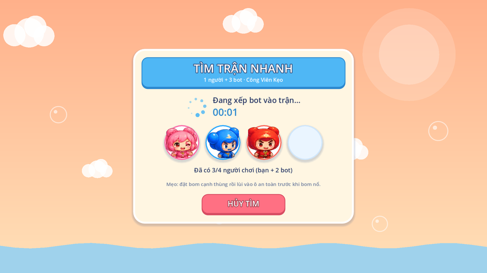 | 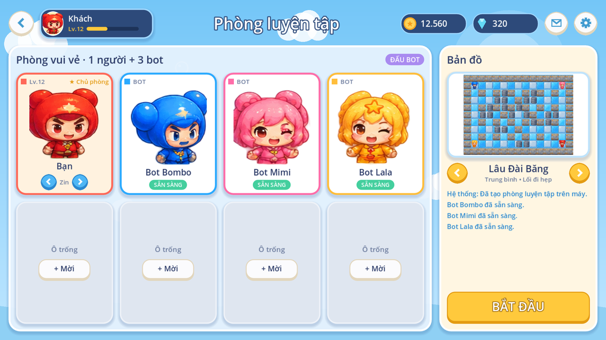 | 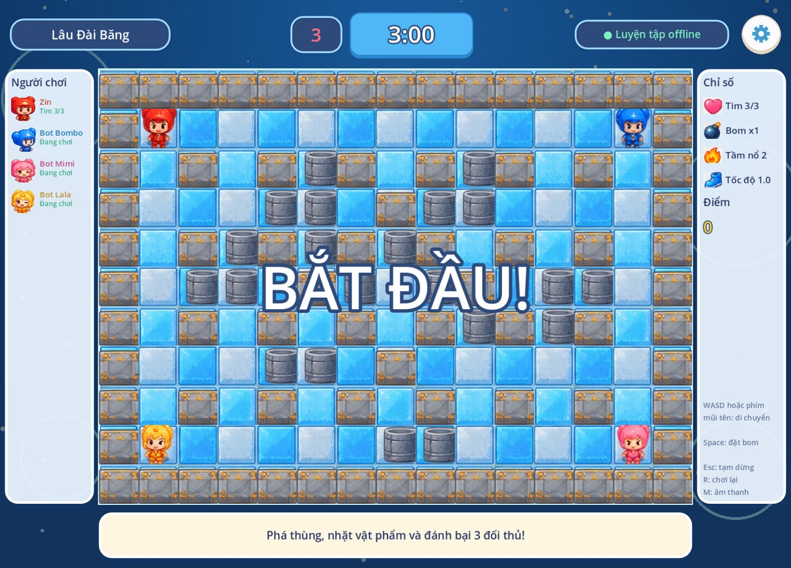    |
| **Kết quả**                                             | **Cửa hàng**                                     | **Trang bị**                                          |
| 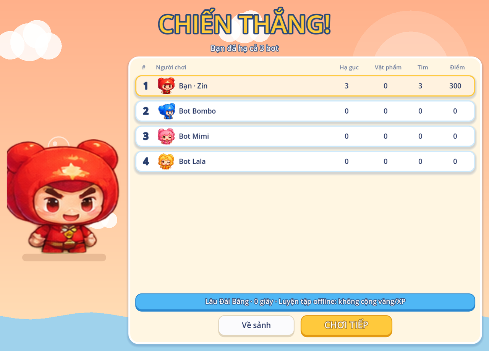      | 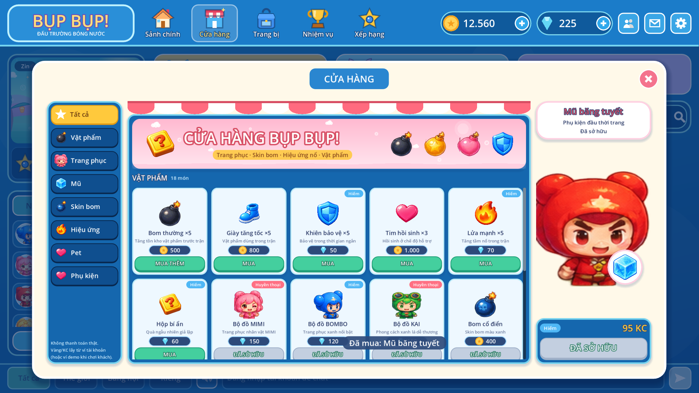 | 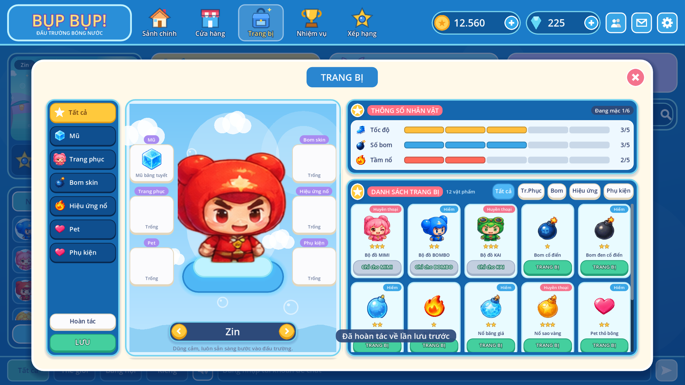 |

```bash
godot --headless --path apps/practice --script res://tests/pc_screens.gd
# Chụp ảnh (cần màn hình/Xvfb): đặt SUNI_CAPTURE_DIR=/thu/muc/anh
```

### Bạn bè, chat và con trỏ chuột

Cần đăng nhập tài khoản (khách chỉ thấy lời nhắc). Sảnh hỏi API mỗi 3 giây.

- **Bạn bè** (tab Bạn bè ở cột trái): tìm theo tên tài khoản, bấm dòng để xem
  thông tin (tên, bang, quan hệ), bấm biểu tượng thêm bạn để gửi lời mời. Người
  kia thấy mục Lời mời kết bạn với nút Đồng ý/Từ chối và thông báo nổi. Bạn bè
  có nút nhắn riêng; lời mời đã gửi có thể hủy.
- **Chat** (thanh dưới): Tất cả, Thế giới, Bang hội, Riêng. Bang hội: nhập tên
  để tạo hoặc gia nhập, có nút Rời bang. Riêng: chọn người nhận trong danh sách
  bạn bè. Tin nhắn 1–200 ký tự, tối đa 5 tin/10 giây. Esc đóng khung chat.
- **Con trỏ chuột**: mũi tên vàng viền xanh navy, chuyển cam khi trỏ vào nút,
  thanh chữ I cùng màu trong ô nhập; mọi kiểu con trỏ khác dùng mũi tên. Vẽ bằng
  code (`scripts/ui/game_cursor.gd`), không dùng ảnh bên ngoài.

API mới (`apps/api/app/social.py`, `recovery.py`) cần bảng trong
`infra/postgres/002_social.sql` và `003_recovery.sql`. Volume mới tự chạy các
file này; volume cũ chạy một lần:

```bash
docker compose exec -T postgres psql -U suni -d suni < infra/postgres/002_social.sql
docker compose exec -T postgres psql -U suni -d suni < infra/postgres/003_recovery.sql
docker compose up -d --build --wait api
```

| Bạn bè                                                 | Chat                                                 | Đổi mật khẩu                                             |
| ------------------------------------------------------ | ---------------------------------------------------- | -------------------------------------------------------- |
| 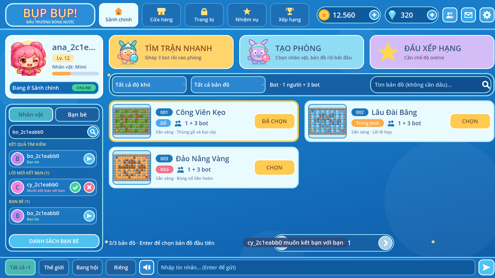       | 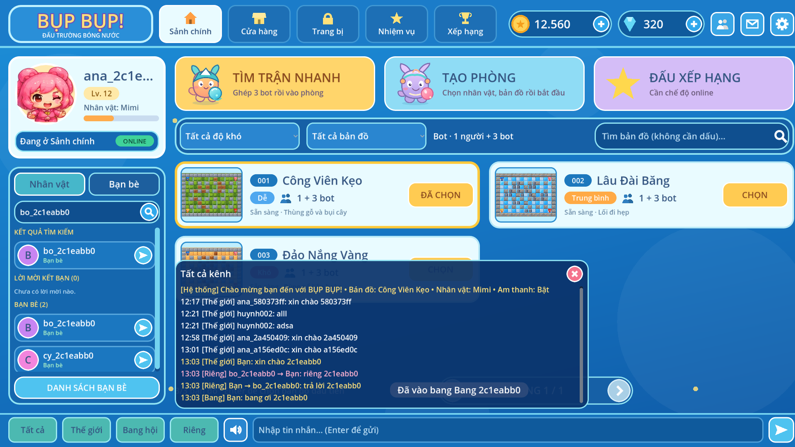        | 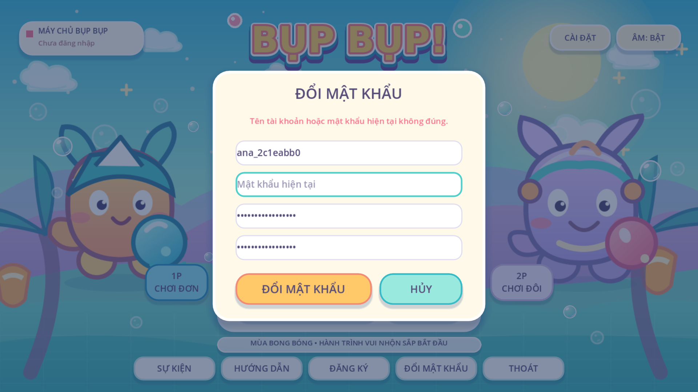 |
| **Quên mật khẩu**                                      | **Con trỏ**                                          |                                                          |
| 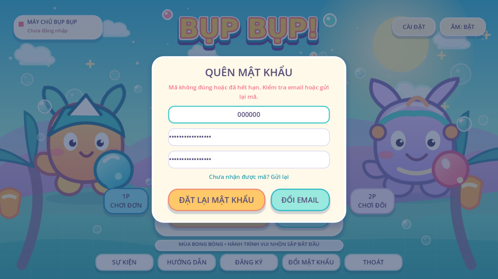 |  |                                                          |

```bash
SUNI_API_URL=http://127.0.0.1:8000 godot --headless --path apps/practice --script res://tests/social.gd
```

### Đồng bộ với admin

Khi đã đăng nhập, app PC dùng ví server (vàng, kim cương, kho đồ, mua vật phẩm do
server tính giá); nút **+** ở ví mở gói nạp sandbox (không thu tiền). Khách và máy
chủ chưa có API mới vẫn dùng ví demo trên máy. Danh mục và ảnh vật phẩm lấy từ
`/v1/catalog` (xem `docs/ADMIN.md`). Phòng và trận luyện tập được báo về admin
dưới dạng “client báo cáo”.

```bash
SUNI_API_URL=http://127.0.0.1:8000 SUNI_ADMIN_USER=<admin thử> SUNI_ADMIN_PASSWORD=<mật khẩu> \
  godot --headless --path apps/practice --script res://tests/sync.gd
```

### Phòng: sẵn sàng và chat

Nút **BẮT ĐẦU** chỉ bật khi mọi ghế đang có người (trừ chủ phòng) đã sẵn sàng; dòng
“Đã sẵn sàng x/y” ngay trên nút. Đổi nhân vật làm các bot xác nhận lại. Khung **Chat
phòng** thay ô nhật ký cũ: thông báo hệ thống, tin của bạn và câu trả lời của bot
(bot chạy trên máy). Khi đã đăng nhập, tin nhắn đi qua kênh phòng của máy chủ
(`channel=room`, chỉ thành viên phòng đọc/gửi được; cần `006_room_chat.sql`), nên
người chơi khác cùng phòng (phòng arena) cũng thấy.

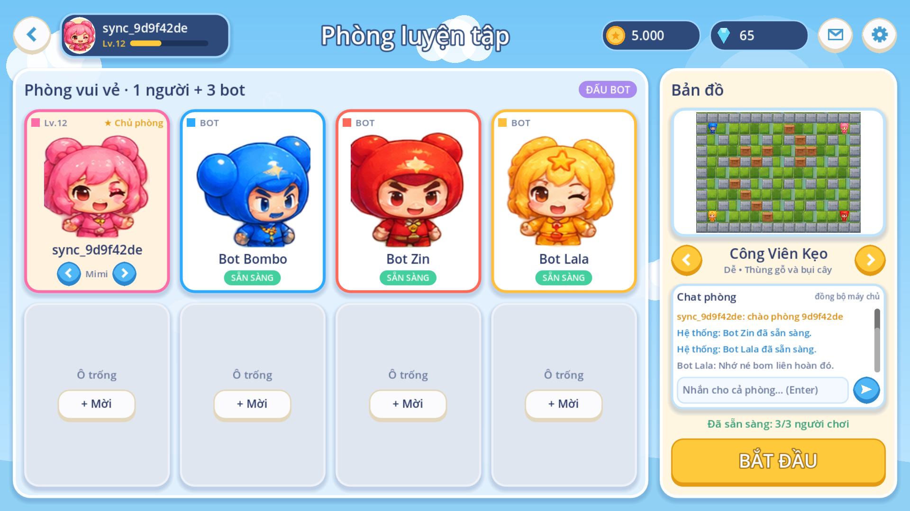

### Trận full màn hình, tab icon, số người chơi, hồ sơ

- **Trận**: không còn viền đen; bàn chơi giữ tỉ lệ 960×704 và phóng to vừa vùng bên
  trái, cột phải có Giới hạn thời gian, Bot còn lại, danh sách người chơi (hạ gục) và
  nút **THOÁT RA** (mở bảng tạm dừng để về sảnh/chơi lại); thanh dưới là chỉ số.
- **Tab trên cùng**: icon màu vẽ bằng code (nhà, cửa hàng, ba lô, cúp, huy hiệu sao),
  tab đang mở có nền sáng mờ, chữ vàng và icon nảy nhẹ.
- **Danh sách bản đồ**: mỗi thẻ có dòng “1 người + 3 bot” và dòng “N người đang chơi · M
  phòng” từ `GET /v1/rooms/summary` (công khai, cập nhật 10 giây); không kết nối được
  API thì ghi “Chưa kết nối máy chủ”.
- **Không bị cắt màn hình**: sảnh và các màn PC thu nhỏ vừa cửa sổ khi nội dung rộng
  hơn thiết kế (font Windows đậm hơn, tên dài); nhãn dài được rút gọn bằng “…”.
- **Hồ sơ**: ảnh nhân vật trên nền đảo, huy hiệu hạng, tên + nút bút chì, Lv và % XP.
  Đã đăng nhập: đổi tên hiển thị qua `PATCH /v1/me` (2–24 ký tự); khách: lưu trên máy.
  Arena dùng tên trong token, nên tên mới hiện trong trận online sau lần đăng nhập kế.

| Trận                                                    | Sảnh                                                    |
| ------------------------------------------------------- | ------------------------------------------------------- |
| 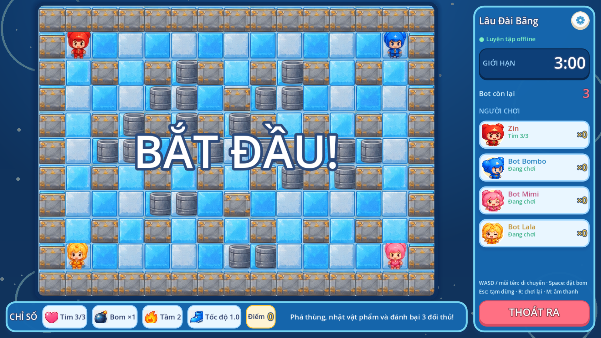 | 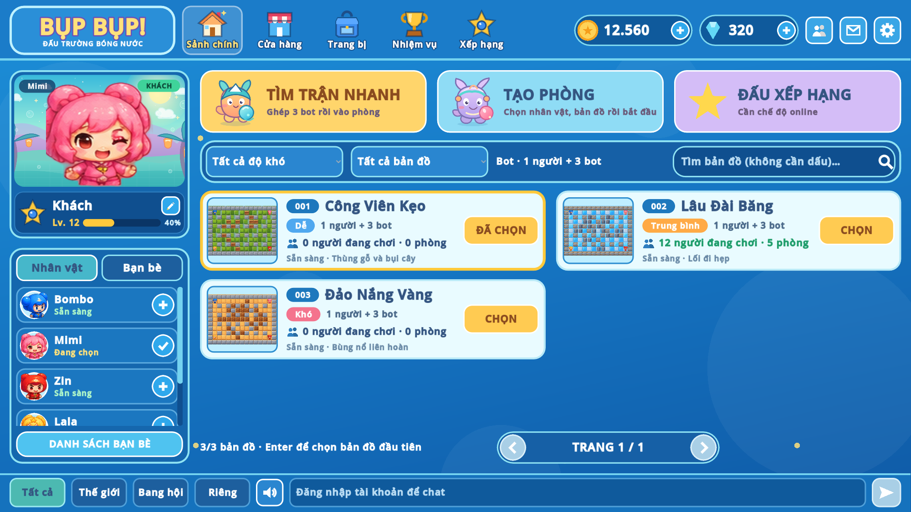 |

### Phòng online trên PC (protocol v2)

Danh sách trong sảnh là **phòng online thật** từ arena (`GET /rooms/v2`), không
còn thẻ “1 người + 3 bot”. Danh sách tự làm mới mỗi 5 giây khi sảnh đang hiện.

- **Thanh lọc**: `Tất cả độ khó ▾ | Tất cả bản đồ ▾ | ☐ Chỉ phòng trống | ☐ Chỉ bạn bè | Tìm phòng…`.
  - **Chỉ phòng trống**: phòng đang chờ và còn ghế, tức vào được ngay.
  - **Chỉ bạn bè**: phòng có ít nhất một người trong danh sách bạn bè đã chấp
    nhận (`GET /v1/friends`, cập nhật 20 giây). Thẻ phòng có bạn được viền vàng.
  - **Tìm phòng**: theo số phòng (`007`) hoặc tên bản đồ, không cần dấu. Enter vào
    phòng còn chỗ đầu tiên khớp.
- **Thẻ phòng** (2 cột × 4 hàng, phân trang `‹ 1 / N ›`):
  - Nội dung: ảnh bản đồ, số `001…`, tên bản đồ, pill độ khó, 👤 `x/8` và ổ khóa
    (xanh là mở, đỏ là đầy hoặc đang chơi).
  - Nút: **Vào** khi còn chỗ; **Đầy** (khóa) khi 8/8; **Đang chơi** (khóa) khi ván
    đang diễn ra, vì server không nhận người vào giữa trận.
- **Tìm trận nhanh**: vào phòng còn chỗ đầu tiên (theo bộ lọc bản đồ nếu có). Nếu
  không có phòng nào, server `joinOrCreate` tạo phòng trên bản đồ đó.
- **Tạo phòng**: chọn một trong ba bản đồ, tối đa 8 người.
- **Luyện tập**: trận bot offline như trước.
- **Phòng chờ online**: 8 ghế (nhân vật, tên, Sẵn sàng hoặc Chưa), thông tin bản đồ,
  nút **SẴN SÀNG** và chat phòng qua API (`roomKey` trong snapshot). Ván bắt đầu khi
  có ít nhất 2 người và mọi người đều sẵn sàng (đếm ngược 3 giây).
- **Trận online**:
  - Bố cục giống trận bot: nền tối, bàn chơi có viền bên trái, thanh **CHỈ SỐ**
    (Bom ×1, Tầm 2, Tốc độ 1.0 theo luật server, Ván) bên dưới, cột phải có bản đồ,
    **GIỚI HẠN**, Còn sống x/N, thẻ người chơi và **THOÁT RA**.
  - Bàn chơi vẽ hoàn toàn từ snapshot server: tường, thùng, bom, lửa, vị trí và
    người thắng. Phím WASD/mũi tên và Space chỉ gửi intent. Esc hỏi trước khi
    rời phòng.
  - Hết ván hiện **BẠN THẮNG / THUA RỒI / HÒA**; sau 8 giây về phòng chờ để
    Sẵn sàng ván mới. Trận được API ghi là đã xác minh, kèm tên bản đồ.
- **Chưa có**: đội, phòng mật khẩu, chủ phòng/kick, vật phẩm trong trận online,
  reconnect. Chế độ khách (không tài khoản) chỉ chơi được Luyện tập.

Kiểm thử thật với stack Docker (API, PostgreSQL, Redis, arena, nginx):

```bash
SUNI_API_URL=http://127.0.0.1:8081/api godot --headless --path apps/practice --script res://tests/online.gd
```

Hai người chơi đăng ký, kết bạn, B tạo phòng `frost`, A thấy phòng ở sảnh (lọc bạn
bè và phòng trống), bấm **Vào**, chat, cả hai Sẵn sàng, A đi một bước, đặt bom và bị
hạ, server chọn B thắng, cả hai về phòng chờ rồi rời phòng.

| Sảnh                                               | Phòng chờ                                          |
| -------------------------------------------------- | -------------------------------------------------- |
| 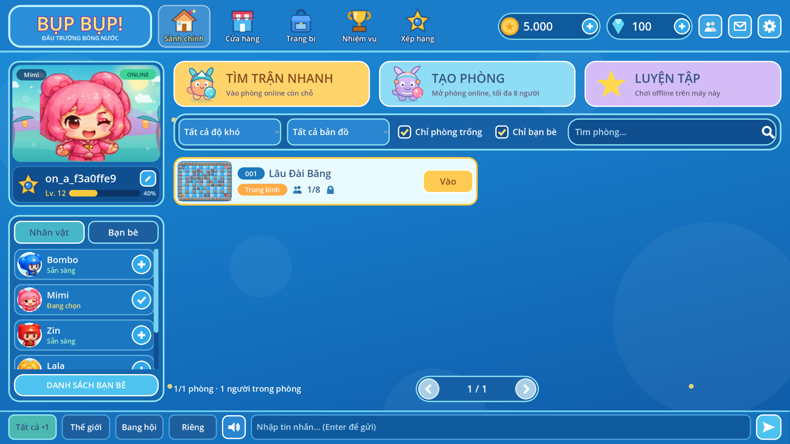  | 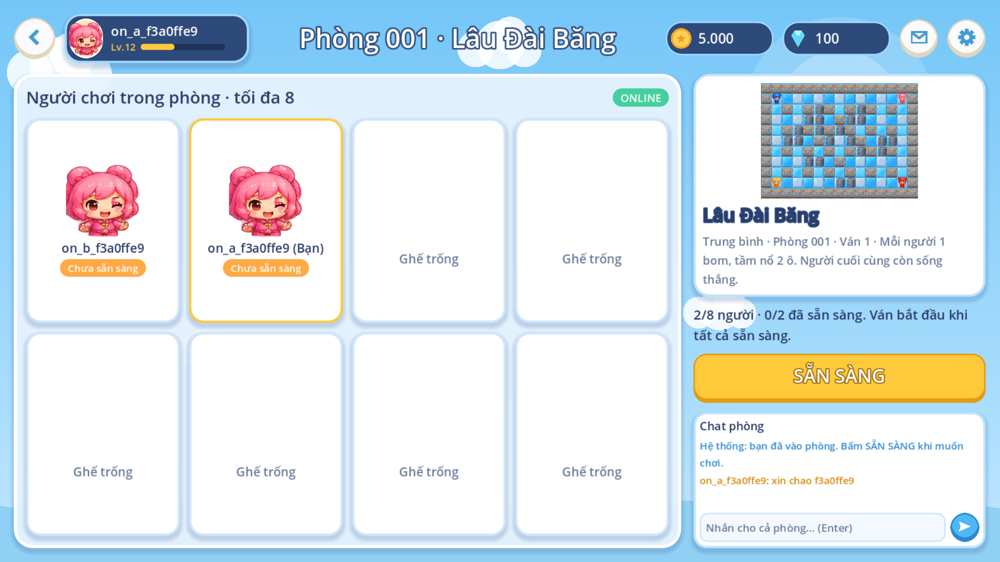   |
| 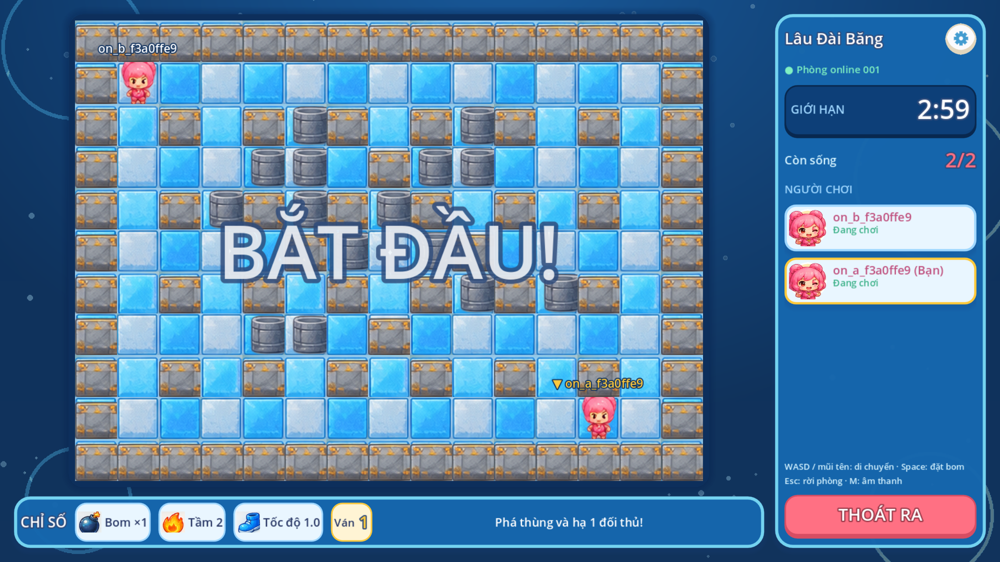 | 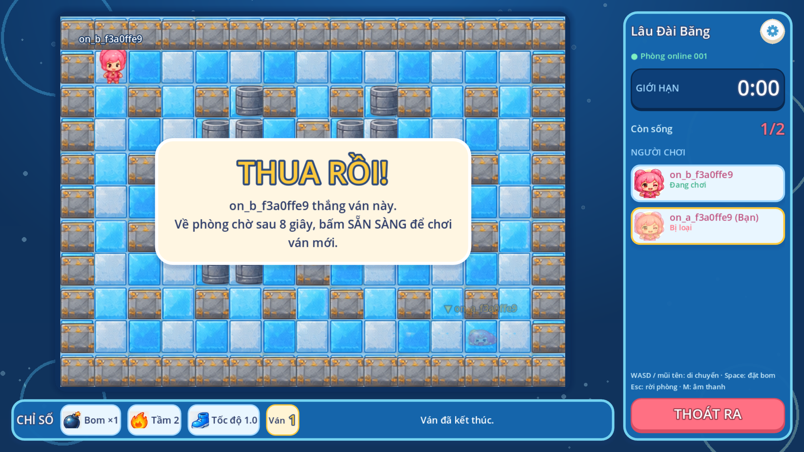 |

### 15 bản đồ: thêm 12 map Boom World (17×13)

Gói `Boom_World_12_Maps_Godot4.zip` thêm 12 map (004–015): Tiệm Bánh Mây, Rừng Nấm
Đom Đóm, Bến Cảng Bong Bóng, Ga Tàu Cầu Vồng, Tháp Đồng Hồ, Hang Pha Lê, Chợ Đêm Đèn
Lồng, Đền Gió Trên Mây, Núi Lửa Kẹo Đỏ, Vườn Sao Rơi, Xưởng Robot Kẹo, Cung Điện Trăng.

- **Ở đâu**: `levels/<id>.json` (định dạng như 3 map cũ, thêm `story`, `pack_id`) và
  `apps/arena/src/maps.ts`; test arena kiểm tra hai bên giống nhau.
- **Sảnh**: hộp **Tạo phòng** là lưới 15 thẻ (ảnh, tên, độ khó, kích thước); bộ lọc
  bản đồ và độ khó, tìm phòng, Tìm trận nhanh và Luyện tập đều có đủ 15 map.
- **Kích thước**: game đọc `columns`/`rows` và `spawns` từ file level. Bàn 17×13 dùng
  cho cả Luyện tập (1 người + 3 bot) và online (8 ghế: 4 góc + 4 điểm giữa cạnh).
- **Hình ảnh**: mỗi map có bộ nền riêng tô theo màu nền của map; tường, thùng, bom và
  hiệu ứng dùng ảnh có sẵn. Ảnh preview vẽ từ dữ liệu map.
- **Luật**: luật Classic như 3 map cũ. Hazard của từng map (hơi nóng, gió…) chưa làm.
  Thùng trong bán kính 2 ô quanh 4 góc xuất phát được dọn, giống server.

| Tạo phòng                                              | Online 17×13                                         | Luyện tập 17×13                                          |
| ------------------------------------------------------ | ---------------------------------------------------- | -------------------------------------------------------- |
| 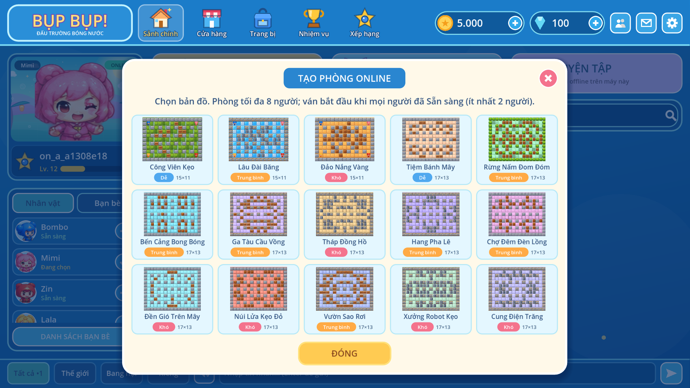 | 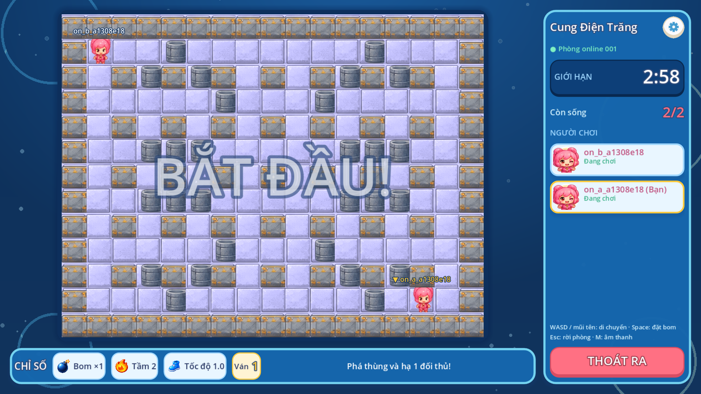 | 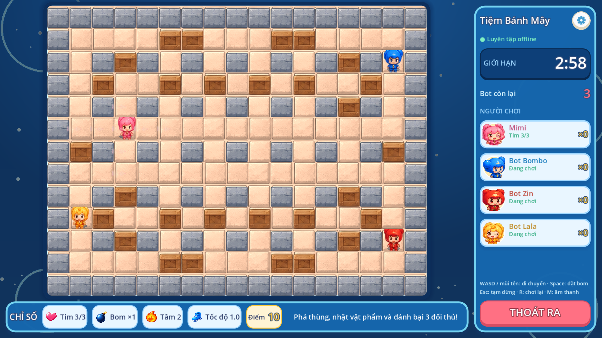 |
