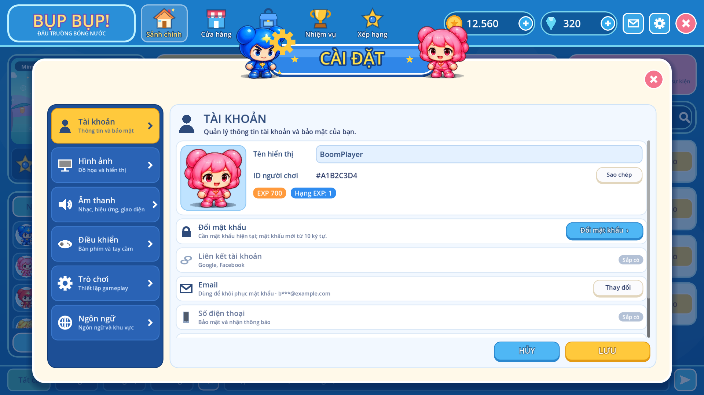
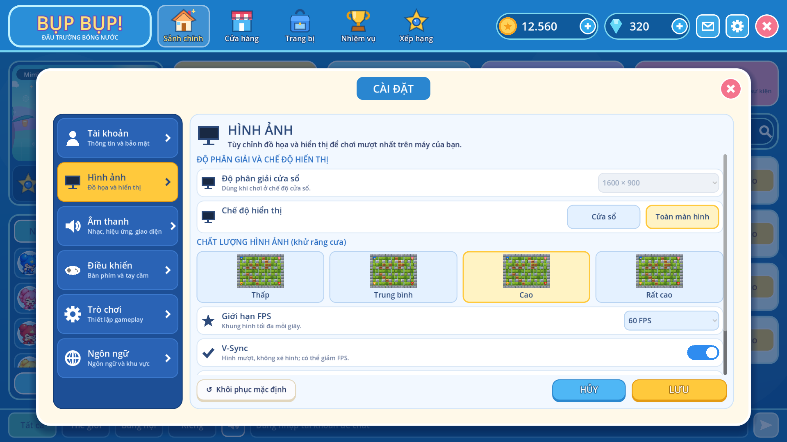
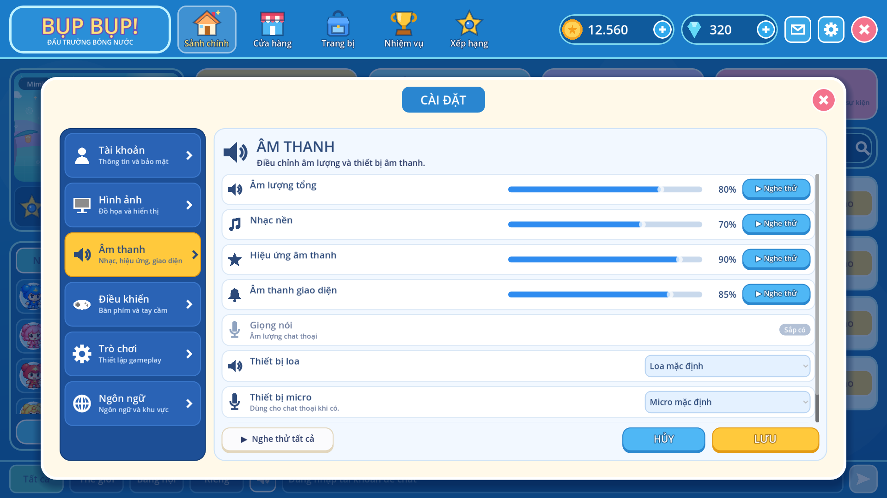
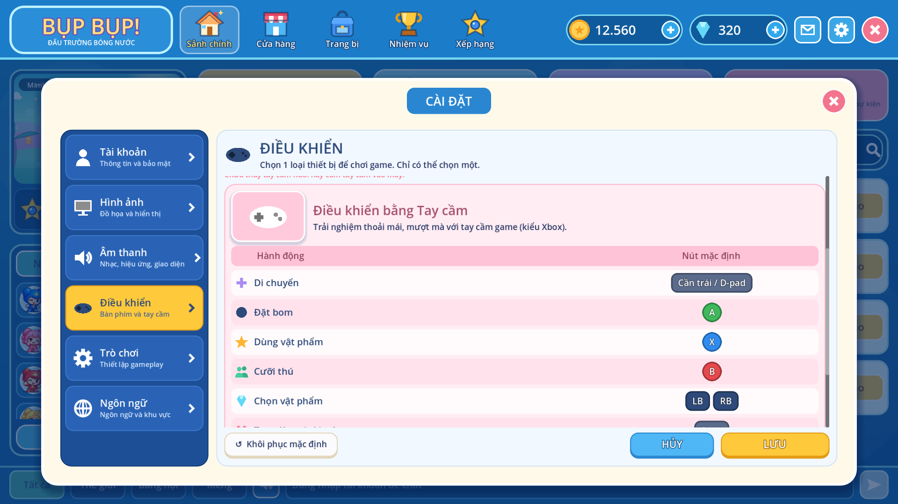

# Cài đặt (app PC)

Nút bánh răng ở sảnh mở cửa sổ **CÀI ĐẶT** (`apps/practice/scripts/ui/pc/pc_settings.gd`). Trong
phòng và trong trận, nút này mở cùng cửa sổ đó, phủ lên màn hình. Có 6 mục: Tài khoản, Hình ảnh, Âm
thanh, Điều khiển, Trò chơi, Ngôn ngữ.

Giá trị lưu ở `user://settings.cfg` trên máy, do autoload `Settings` (`scripts/settings.gd`) đọc và
áp dụng khi mở game. Cửa sổ sửa một bản nháp:

- Âm lượng nghe ngay khi kéo.
- **LƯU** áp dụng và lưu.
- **HỦY**, hoặc đóng cửa sổ, trả lại giá trị đã lưu.
- **Khôi phục mặc định** chỉ đặt lại mục đang mở.

Tùy chọn chưa làm được hiện màu xám kèm nhãn **Sắp có**, không giả vờ hoạt động.

## Hoạt động thật

| Mục        | Tùy chọn                                                                                                                 |
| ---------- | ------------------------------------------------------------------------------------------------------------------------ |
| Tài khoản  | Ảnh nhân vật (chân dung động), tên hiển thị (lưu khi bấm LƯU), ID người chơi và nút sao chép, EXP và hạng EXP            |
|            | Đổi mật khẩu (cần mật khẩu hiện tại), email khôi phục, đăng xuất. Khách thấy nút về màn hình đăng nhập                   |
| Hình ảnh   | Cửa sổ / toàn màn hình, độ phân giải cửa sổ, chất lượng (khử răng cưa 2D: tắt, 2×, 4×, 8×)                               |
|            | Giới hạn FPS (30, 60, 120, không giới hạn), V-Sync, độ sáng (lớp phủ toàn màn), hiện tên người chơi trong trận online    |
| Âm thanh   | Âm lượng tổng, nhạc nền, hiệu ứng, âm giao diện (bus `Master` > `Music`, `SFX`, `UI`) kèm nút Nghe thử                   |
|            | Chọn loa và micro, tắt tiếng khi cửa sổ mất focus                                                                        |
| Điều khiển | Chọn **một** thiết bị: Bàn phím hoặc Tay cầm (thẻ lớn), bảng phím / nút của thiết bị đó hiện ngay bên dưới               |
|            | Tay cầm: rung khi bom nổ, độ nhạy / deadzone; cả hai: gợi ý phím trên nút DÙNG / THÚ CƯỠI, tự nhận tay cầm khi cắm / rút |
| Trò chơi   | Tự động sẵn sàng (phòng online), rung bàn chơi khi bom nổ, rung tay cầm khi bom nổ, xác nhận rời trận                    |
| Ngôn ngữ   | Tiếng Việt, máy chủ đang dùng (đổi ở màn hình đăng nhập), bộ lọc chat (ẩn từ ngữ thô tục trong chat sảnh và phòng)       |

**Sắp có:** liên kết Google/Facebook, số điện thoại, 2FA cho người chơi, âm lượng giọng nói, giao diện
English/한국어/日本語/中文, ngôn ngữ thoại và phụ đề, đổi phím.

Không có trong game nên không đưa vào: minimap, tốc độ camera (bàn chơi luôn hiện toàn bộ), khóa 8
hướng (lưới 4 hướng), tự nhặt vật phẩm (đi qua là nhặt).

## Điều khiển

Chỉ một thiết bị hoạt động. Khi chọn Tay cầm, các phím chơi bị bỏ qua (Esc vẫn dùng được); khi chọn
Bàn phím, tay cầm bị bỏ qua. Luyện tập và online dùng cùng cách bấm:

| Hành động     | Bàn phím          | Tay cầm (kiểu Xbox)    |
| ------------- | ----------------- | ---------------------- |
| Di chuyển     | WASD / mũi tên    | Cần trái hoặc D-pad    |
| Đặt bom       | Space             | A                      |
| Dùng vật phẩm | Ctrl              | X                      |
| Cưỡi thú      | Q                 | B                      |
| Chọn vật phẩm | 1–6               | LB / RB                |
| Tạm dừng, rời | Esc               | Start                  |
| Trong menu    | chuột, Enter, Esc | A xác nhận, B quay lại |

Deadzone 0–100 tương ứng độ nghiêng cần tối thiểu 0,05–0,65 (mặc định 50 là 0,35).

## API mới

Đều cần đăng nhập người chơi.

- `GET /v1/me` trả thêm `username` (tên đăng nhập) và `email` đã che (`b***@example.com`).
- `POST /v1/me/password` `{password, new_password}`: mật khẩu mới từ 10 ký tự. Trả 204; mật khẩu hiện
  tại sai trả 401; tài khoản khách trả 403.
- `PUT /v1/me/email` `{password, email}`: đổi email nhận mã quên mật khẩu, trả email đã che. Mật khẩu
  sai trả 401, email đã có người dùng trả 409. Chưa có bước xác thực email bằng mã.

## Kiểm thử

- `apps/practice/tests/settings.gd`:
  - Bus âm thanh, lưu và đọc lại, bộ lọc chat, độ sáng.
  - Mở đủ 6 mục từ nút bánh răng; mục "Sắp có" không bấm được.
  - Bản nháp, LƯU và HỦY (kể cả trả lại âm lượng đang nghe thử), Khôi phục mặc định.
  - Màn tài khoản khi đăng nhập, form đổi mật khẩu, cửa sổ phủ trong phòng.
  - Ảnh chụp với `SUNI_CAPTURE_DIR`.
- `apps/api/tests/test_api.py::test_settings_change_own_password_and_email_need_the_current_password`.

