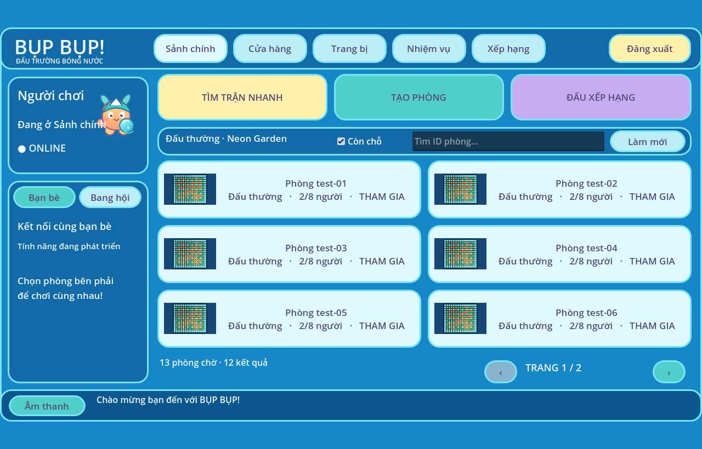

# Sảnh chính PC sau đăng nhập

Client `apps/client` mở sảnh chính sau đăng nhập hoặc chơi khách, giữ phiên trong RAM.
Bố cục Control Godot lấy cảm hứng từ handoff MainLobby 1280×720 của người dùng:
menu, hồ sơ, khu vực bạn bè, hành động trận, bộ lọc, sáu phòng/trang và thanh trạng thái.
Không nhập SVG chứa số liệu mẫu; tái sử dụng hình Píp và thumbnail hiện có.

- Phòng và số người lấy từ arena local; tự cập nhật mỗi 5 giây.
- Tìm ID, lọc còn chỗ, phân trang; phòng đầy và thao tác đang chờ bị khóa.
- Tìm nhanh chọn phòng có chỗ hoặc tạo phòng; server xác nhận việc tham gia.
- Tạo phòng dùng chế độ/bản đồ mặc định; rời phòng trở lại sảnh.
- Đăng xuất xóa phiên; lỗi mạng hiển thị dưới sảnh để thử lại.
- Bạn bè, bang hội, cửa hàng, trang bị, nhiệm vụ và xếp hạng chỉ thông báo chưa hỗ trợ.
  Không giả lập số dư, cấp độ, chat hay dữ liệu xã hội.
- Không sửa web, practice hoặc backend trong commit này.

## Kiểm thử

Godot 4.4.1: `scripts/check-godot.py`, `tests/main_lobby.gd`, `tests/rooms.gd`
và `tests/accounts.gd` đạt; hai test mạng chạy với API :8000 và arena :2567 local.
Ảnh chụp từ Godot OpenGL qua Xvfb, dùng phòng fixture, không phải phòng online thật.
Chưa kiểm thử bản executable Windows hoặc âm thanh trên thiết bị thật.
